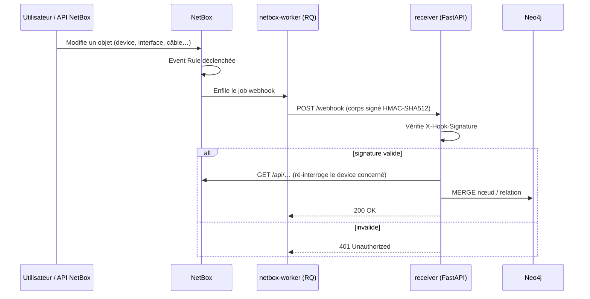
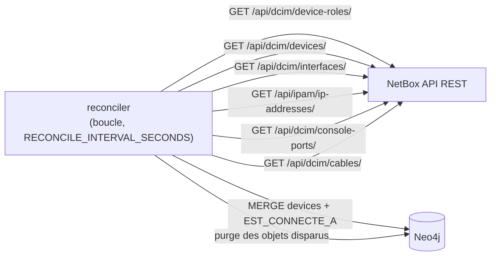
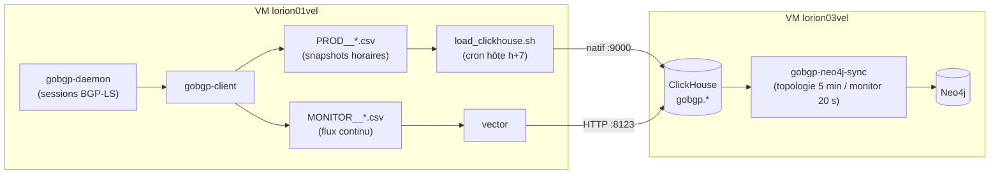
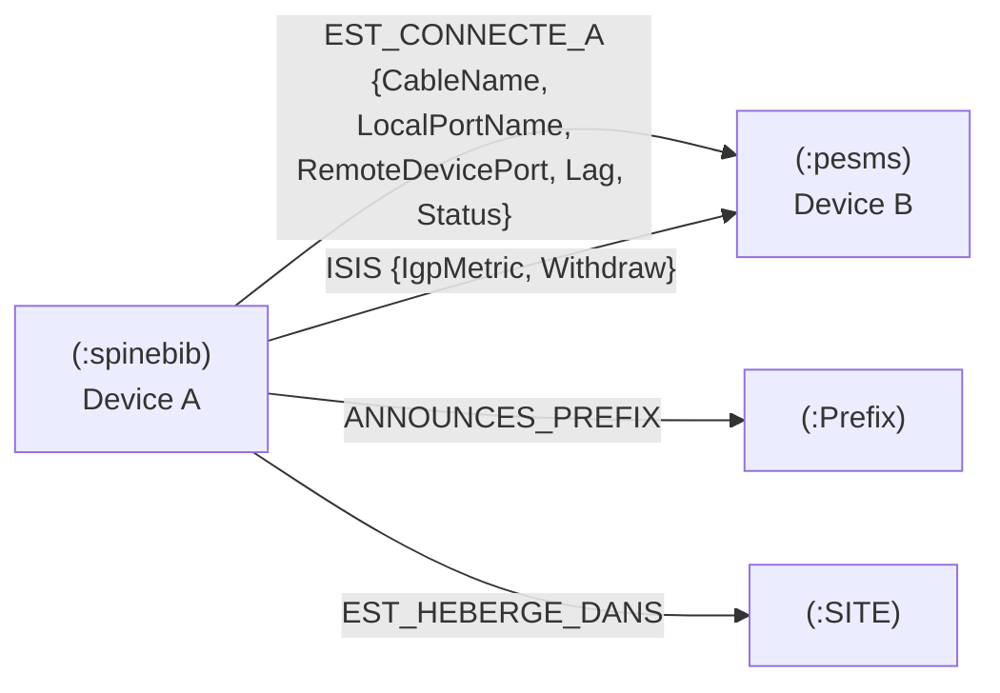

# Flux de données

Le graphe Neo4j est alimenté par **deux sources de vérité** :

- **NetBox** (DCIM) → deux chemins complémentaires (webhooks temps réel + reconciler
  périodique) — sections 1 et 2 ;
- **BGP-LS** (réseau vivant) → collecte gobgp sur `lorion01vel`, transit par ClickHouse,
  puis greffe sur le graphe — section 3.

## 1. Chemin temps réel NetBox (webhooks)

Points clés (réels) :

- NetBox envoie le champ **`object_type`** (ex. `dcim.device`) — pas `model` — et un `event`
  (`created`/`updated`/`deleted`). Le receiver en déduit le modèle et l'action.
- Le corps est **signé HMAC-SHA512** avec `WEBHOOK_SECRET` ; le receiver rejette toute
  signature invalide (401).
- Modèle **dénormalisé** : sur réception, le receiver **ré-interroge NetBox** pour reconstruire
  le nœud device complet (le webhook seul ne contient pas toutes les données jointes).

## 2. Chemin périodique NetBox (reconciler)

- Balaye l'ensemble des objets, reconstruit les nœuds et relations, puis **purge** ce qui a
  disparu de NetBox (rattrapage des webhooks manqués et des suppressions hors-ligne).
- Intervalle configurable (`RECONCILE_INTERVAL_SECONDS`, défaut 900 s).

## Objets NetBox synchronisés

| Objet NetBox | Endpoint | Rôle dans le graphe |
|--------------|----------|---------------------|
| Device Role | `/api/dcim/device-roles/` | Label du nœud (rôle) + `Fonction` (rôle racine) |
| Device | `/api/dcim/devices/` | Nœud device (propriétés dénormalisées) |
| Interface | `/api/dcim/interfaces/` | LAG, état, port des relations |
| IP Address | `/api/ipam/ip-addresses/` | Propriété `Loopback*` |
| Console Port | `/api/dcim/console-ports/` | Propriété `ConsolePorts` |
| Cable | `/api/dcim/cables/` | Relation `EST_CONNECTE_A` device↔device |

## 3. Chemin BGP-LS (gobgp → ClickHouse → Neo4j)

- Les **snapshots** (`PROD__*` → tables `bgp_ls_*`/`SAFI_*`) portent l'état complet ;
  les **événements** (`MONITOR__*` → tables `monitor_bgp_*`) portent la fraîcheur.
- `gobgp-neo4j-sync` **greffe** cette topologie sur les nœuds équipement créés par le
  sync NetBox : relations `ISIS`, `ANNOUNCES_PREFIX`, `ANNOUNCES_ROUTE`, nœuds `:Prefix`.
  Voir [gobgp-neo4j-sync / Modèle de données](../services/gobgp-neo4j-sync/data-model.md).

## Résultat dans Neo4j

Le modèle cible est **dénormalisé** : un nœud par device, étiqueté par son **rôle**, relié aux
autres devices par des relations `EST_CONNECTE_A` (câblage NetBox) et `ISIS` (adjacences
BGP-LS), rattaché à son `:SITE` (`EST_HEBERGE_DANS`) et à ses préfixes annoncés
(`ANNOUNCES_PREFIX` / `ANNOUNCES_ROUTE` vers `:Prefix`). Voir
[netbox-neo4j-sync / Modèle de données](../services/netbox-neo4j-sync/data-model.md) et
[gobgp-neo4j-sync / Modèle de données](../services/gobgp-neo4j-sync/data-model.md).

!!! note "Cohérence"
    Tous les chemins écrivent avec des `MERGE` idempotents. Le temps réel (webhooks,
    monitor) apporte la faible latence ; les reconcilers garantissent la convergence
    (sources de vérité : NetBox pour le DCIM, ClickHouse/BGP-LS pour le routage).
