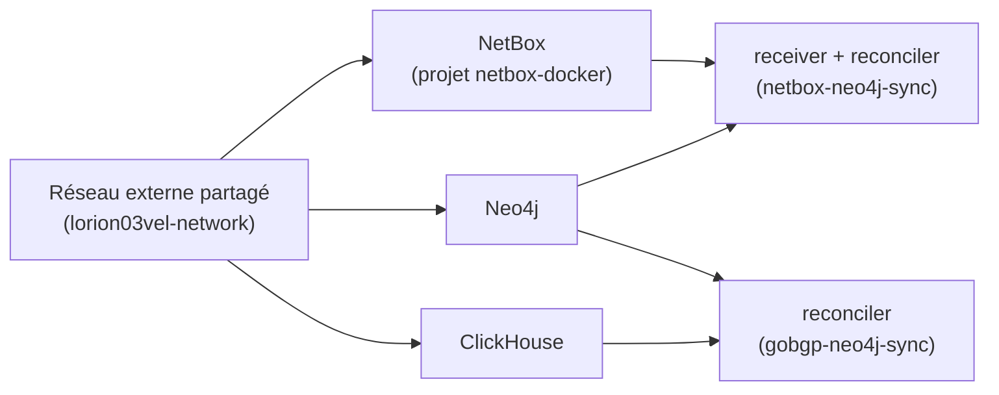

# Déploiement (architecture)

## Projet Compose `lorion03vel`

Le fichier racine `orion-lab-stack/lorion03vel/docker-compose.yml` définit le projet
**`lorion03vel`** et agrège les services via le mécanisme **`include`** de Compose :

```yaml
name: lorion03vel

include:
  - path: clickhouse/compose.yml
    env_file: clickhouse/.env
  - path: neo4j/compose.yml
    env_file: neo4j/.env
  - path: netbox-neo4j-sync/compose.yml
    env_file: netbox-neo4j-sync/.env
  - path: gobgp-neo4j-sync/compose.yml
    env_file: gobgp-neo4j-sync/.env

networks:
  lorion03vel-network:
    name: lorion03vel-network
    external: true
```

!!! info "Quatre stacks incluses"
    ClickHouse, Neo4j et les deux applications de synchronisation (`netbox-neo4j-sync`,
    `gobgp-neo4j-sync`) démarrent ensemble sous le projet `lorion03vel`.

Chaque `include` référence :

- un `path` vers le `compose.yml` du service,
- un `env_file` (le `.env` du service) utilisé pour l'**interpolation** des variables.

Les `container_name` étant fixes, tous les services apparaissent sous le **même projet**
`lorion03vel` et se pilotent ensemble.

## Ordre de démarrage



1. Les **réseaux externes** doivent exister — leur cycle de vie est géré par le
   **Makefile de la VM** (`make network`, intégré à `make up`), jamais à la main.
2. **NetBox** (projet séparé) doit tourner — c'est la source de données du sync DCIM.
3. **Neo4j** démarre et charge ses plugins ; **ClickHouse** démarre et reçoit les données
   BGP-LS poussées depuis `lorion01vel`.
4. **receiver** et **reconciler** (netbox-neo4j-sync) démarrent ; le reconciler crée les
   contraintes puis lance un premier cycle de synchronisation.
5. Le **reconciler gobgp-neo4j-sync** démarre ses deux boucles (topologie + monitor).

## Commandes de référence

=== "Piloter toute la stack lorion03vel"

    ```bash
    cd orion-lab-stack/lorion03vel
    make up                       # réseau (si absent) + build + up -d
    make ps
    docker compose logs -f reconciler
    make down                     # le réseau partagé reste en place
    ```

=== "Un service précis"

    ```bash
    docker compose up -d neo4j
    docker compose up -d --build receiver reconciler
    docker compose restart reconciler
    ```

=== "CLI d'administration"

    ```bash
    docker compose run --rm reconciler python -m admin stats
    docker compose run --rm reconciler python -m admin setup-webhooks
    ```

Voir le déroulé complet dans [Exploitation / Déploiement complet](../operations/deployment.md).
