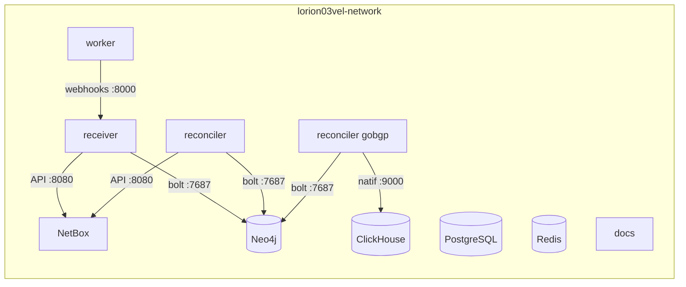

# Réseau

## Réseaux Docker

Chaque VM a son **réseau bridge externe partagé** (déclaré `external: true`, donc géré
hors du cycle de vie d'un projet Compose — c'est le **Makefile de la VM** qui le crée) :

| Réseau | VM | Créé par | Services attachés |
|--------|----|----------|-------------------|
| `lorion01vel-network` | lorion01vel | `make up` / `make network` | gobgpd, gobgp-cli, vector |
| `lorion02vel-network` | lorion02vel | `make up` / `make network` | grafana |
| `lorion03vel-network` | lorion03vel | `make up` / `make network` | NetBox (+ worker, PostgreSQL, Redis ×2), Neo4j, ClickHouse, receiver, reconciler, reconciler gobgp, docs |

**Un seul réseau par VM** : la stack `netbox-docker` est rattachée au réseau partagé
via son `docker-compose.override.yml`, comme toutes les autres stacks de la VM. Le
receiver/reconciler y joignent Neo4j et l'API NetBox, et NetBox y appelle le receiver
pour les webhooks. (L'ancien réseau `netbox-docker_default`, créé par le projet
`netbox-docker` avant le rattachement au réseau partagé, a été supprimé.)



!!! info "Pourquoi `external: true` — et jamais de création manuelle"
    Les réseaux `lorionXXvel-network` sont `external` pour être **partagés** par toutes
    les stacks de la VM sans être détruits/recréés par un `docker compose down`. Leur
    cycle de vie appartient au **Makefile** (`make network`, intégré à `make up` ;
    suppression par `make purge`) — pas de `docker network create` à la main, pour
    garder la main sur les subnets (`make subnets` liste l'existant).

## Communication inter-VM

Pas de réseau overlay : les flux entre VM passent par les **ports publiés** et les IP
routées du lab.

| Source (VM) | Destination (VM) | Voie |
|-------------|------------------|------|
| vector (lorion01vel) | ClickHouse (lorion03vel) | `http://10.10.3.141:8123` (port publié) |
| grafana (lorion02vel) | ClickHouse (lorion03vel) | natif `10.10.3.141:9000` (port publié) |
| `load_clickhouse.sh` — hôte (lorion01vel) | ClickHouse (lorion03vel) | natif `10.10.3.141:9000` (port publié) |
| Réflecteurs BGP | gobgpd (lorion01vel) | BGP `203.0.113.1:1790` (port publié) |

!!! warning "Deux pièges réseau propres à cette infra"
    - **Hairpin NAT bloqué** : un conteneur de lorion03vel ne peut **pas** joindre
      `10.10.3.141` (sa propre VM) — utiliser le nom Docker (`lorion03vel-clickhouse`).
      L'IP hôte n'est valable que **depuis une autre VM**.
    - **`/etc/hosts` périmé** : sur certaines VM, le nom `lorion03vel` pointe vers une
      autre instance — utiliser l'**IP directe** dans les configurations inter-VM.
    - **Miroir d'images : CA interne requise** : le certificat de
      `registry.example.com` est signé par la CA interne. Sur une VM neuve,
      les pulls échouent en `x509: unknown authority` tant que `internal-root.crt`
      (cf. `/usr/local/share/ca-certificates/` de lorion03vel) n'est pas installée
      (`update-ca-certificates` + restart docker). Contournement sans sudo :
      `docker save <image> | gzip | ssh <vm> 'gunzip | docker load'`.

## Résolution DNS : conteneur vs hôte

C'est un point de confusion récurrent. Les **noms de service** ne sont résolubles que
**depuis les conteneurs** du réseau concerné, jamais depuis l'hôte.

| Cible | Depuis un conteneur du réseau | Depuis l'hôte |
|-------|-------------------------------|---------------|
| NetBox | `http://netbox:8080` | `http://localhost:9998` (port publié) |
| Neo4j | `bolt://lorion03vel-neo4j:7687` | `bolt://localhost:7687` (port publié) |
| ClickHouse | `lorion03vel-clickhouse:9000` | `localhost:9000` (port publié) |
| receiver | `http://netbox-neo4j-sync-receiver:8000` | *(non publié)* |

!!! example "Démonstration"
    ```bash
    # Depuis un conteneur de la stack -> 200
    docker compose run --rm reconciler python -c \
      "import httpx; print(httpx.get('http://netbox:8080/api/status/', \
       headers={'Authorization':'Token <TOKEN>'}).status_code)"

    # Depuis l'hôte : 'netbox' ne résout pas -> utiliser localhost:9999
    ```

## Cartographie des ports

### VM lorion03vel

| Service | Port interne | Port publié sur l'hôte | Protocole |
|---------|-------------|------------------------|-----------|
| Neo4j — HTTP | 7474 | 7474 | HTTP (navigateur / API) |
| Neo4j — Bolt | 7687 | 7687 | Bolt (driver) |
| ClickHouse — HTTP | 8123 | 8123 | HTTP |
| ClickHouse — natif | 9000 | 9000 | TCP natif |
| netbox-neo4j-sync — receiver | 8000 | *(non publié)* | HTTP (webhooks) |
| Documentation (nginx) | 80 | 8090 | HTTP |
| NetBox | 8080 (unit) | 9998 (9999 = NetBox de PROD) | HTTP |
| PostgreSQL (NetBox) | 5432 | *(interne)* | TCP |
| Redis / Redis-cache (NetBox) | 6379 | *(interne)* | TCP |

### VM lorion02vel

| Service | Port interne | Port publié sur l'hôte | Protocole |
|---------|-------------|------------------------|-----------|
| Grafana | 3000 | 3000 | HTTP |

### VM lorion01vel

| Service | Port interne | Port publié sur l'hôte | Protocole |
|---------|-------------|------------------------|-----------|
| gobgpd — BGP | 179 | **1790** | BGP |
| gobgpd — gRPC | 50051 | **50052** | gRPC |
| vector | *(aucun)* | *(aucun)* | — |

!!! warning "179/50051 appartiennent au gobgpd de production"
    Le daemon systemd de prod tient les ports standard sur l'hôte : le conteneur est
    volontairement décalé (1790/50052).

!!! note "Le receiver n'est pas publié sur l'hôte"
    NetBox appelle le receiver par son **nom de conteneur** sur `lorion03vel-network`
    (`http://netbox-neo4j-sync-receiver:8000/webhook`). Aucune publication de port hôte
    n'est nécessaire, ce qui réduit la surface d'exposition.

## Matrice de communication

| Source | Destination | Protocole / Port | Objet |
|--------|-------------|------------------|-------|
| NetBox (worker) | receiver | HTTP `:8000` | Webhooks d'événements (POST signé HMAC) |
| reconciler | NetBox | HTTP `:8080` | Lecture API REST (`/api/dcim/…`, `/api/ipam/…`) |
| receiver | NetBox | HTTP `:8080` | Enrichissement (resync d'un device) |
| receiver / reconciler | Neo4j | Bolt `:7687` | Écriture du graphe |
| reconciler gobgp | ClickHouse | natif `:9000` | Lecture tables `gobgp.*` |
| reconciler gobgp | Neo4j | Bolt `:7687` | Écriture du graphe |
| vector (lorion01vel) | ClickHouse | HTTP `:8123` (inter-VM) | Insertion `monitor_bgp_*` |
| grafana (lorion02vel) | ClickHouse | natif `:9000` (inter-VM) | Lecture `gobgp.*` (user read-only) |
| cron hôte (lorion01vel) | ClickHouse | natif `:9000` (inter-VM) | Insertion snapshots |
| Réflecteurs BGP | gobgpd | BGP `:1790` | Sessions BGP-LS |
| gobgp-cli | gobgpd | gRPC `:50051` (interne) | Extraction RIB |
| NetBox | PostgreSQL | TCP `:5432` | Base de données |
| NetBox / worker | Redis | TCP `:6379` | Cache & files RQ |
