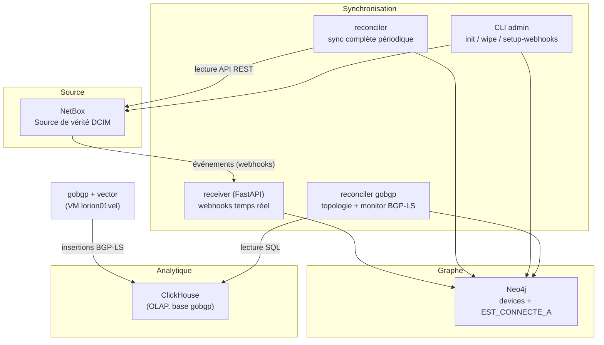
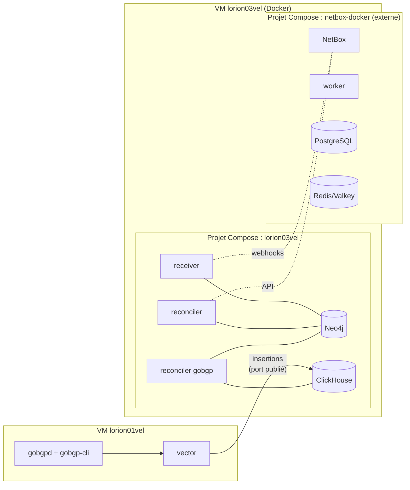

# Vue générale

## Objectif de la plateforme

La plateforme Orion projette l'**infrastructure réseau décrite dans NetBox** dans une base
**Neo4j** orientée graphe, afin de raisonner sur la topologie (parcours de câblage, voisinage,
algorithmes de graphe via GDS). Une base **ClickHouse** reçoit les données **BGP-LS**
collectées sur la VM `lorion01vel` (gobgp + vector). Deux applications de synchronisation
alimentent le graphe : `netbox-neo4j-sync` (cohérence NetBox → Neo4j en **temps réel** via
webhooks + **rattrapage périodique** via reconciler) et `gobgp-neo4j-sync` (topologie BGP-LS
ClickHouse → Neo4j).

## Vue logique

| Couche | Rôle | Composant réel |
|--------|------|----------------|
| Source | Référentiel d'infrastructure (DCIM) | NetBox v4.5.4 |
| Source | Topologie BGP-LS | gobgp + vector (VM `lorion01vel`) |
| Synchronisation | Alimentation du graphe | `netbox-neo4j-sync` (receiver, reconciler, CLI) · `gobgp-neo4j-sync` (reconciler) |
| Graphe | Modèle exploitable | Neo4j 5.26.0 + APOC + GDS |
| Analytique | Requêtes OLAP | ClickHouse 25.6 (base `gobgp`) |

## Vue physique

Les services sont répartis sur **plusieurs VM du lab** : la collecte BGP-LS sur
`lorion01vel`, le stockage et l'enrichissement sur la VM hébergeant le projet
`lorion03vel`. Sur cette dernière, deux projets Docker Compose coexistent :

- **Projet `lorion03vel`** : défini dans ce dépôt (`orion-lab-stack/lorion03vel/docker-compose.yml`),
  agrège Neo4j, ClickHouse, `netbox-neo4j-sync` et `gobgp-neo4j-sync` via le mécanisme `include`.
- **Projet `netbox-docker`** : déployé hors de ce dépôt (`/home/services/netbox-docker/`),
  fournit NetBox et ses dépendances.
- **Stack `lorion01vel`** : définie dans ce dépôt (`orion-lab-stack/lorion01vel/`),
  collecte BGP-LS (gobgp) et expédie vers ClickHouse (vector).

Les deux projets communiquent via des **réseaux Docker partagés** (voir [Réseau](networking.md)).

## Principes structurants

!!! abstract "Décisions d'architecture réellement appliquées"
    - **Pas de bus de messages** : la synchro temps réel repose directement sur les
      **webhooks NetBox** (HTTP) vers le receiver, sans Kafka/RabbitMQ.
    - **Deux mécanismes complémentaires** : webhooks (faible latence) + reconciler
      (garantie de cohérence, rattrapage des événements manqués).
    - **Idempotence** : toutes les écritures Neo4j sont des `MERGE`, ce qui autorise
      receiver et reconciler à s'exécuter en parallèle sans conflit.
    - **Secrets hors dépôt** : mots de passe dans des fichiers `secrets/` (montés) ou
      `.env` non committés, jamais en clair dans les fichiers de configuration versionnés.
    - **Images via miroir interne** : toutes les images tierces proviennent de
      `registry.example.com/dockerhub/…` (préfixe paramétré par `${REGISTRY}`) ;
      les images buildées localement sont nommées `orion/<service>:<tag>`
      (voir [Infrastructure](infrastructure.md)).

## Pour aller plus loin

- [Infrastructure](infrastructure.md) — hôte, Docker, miroir d'images, isolation Internet.
- [Réseau](networking.md) — réseaux Docker, résolution DNS, ports.
- [Flux de données](data-flow.md) — détail du cheminement NetBox → Neo4j.
- [Sécurité](security.md) — secrets, authentification, état réel TLS/reverse proxy.
- [Déploiement](deployment.md) — projet Compose et ordre de démarrage.
