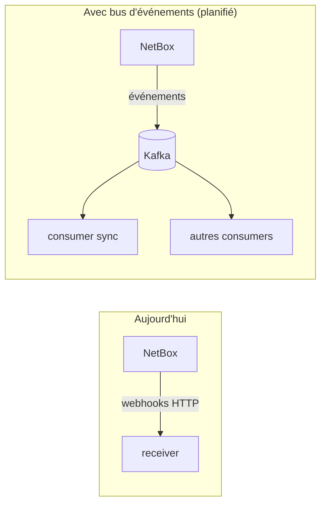

# Roadmap — services à venir

Cette page liste les technologies **prévues** pour la plateforme mais **non encore
déployées**. Elles sont documentées ici de façon transparente afin de ne rien inventer dans
les pages de services : tant qu'un composant n'existe pas réellement dans le dépôt, il n'a
pas de page de service dédiée.

!!! warning "Aucune configuration ci-dessous n'est implémentée"
    Les éléments suivants représentent une **intention d'architecture**. Ils seront
    documentés en détail (avec le modèle de service standard) au moment de leur ajout réel.

## Services planifiés

| Service | planifié Rôle envisagé |
|---------|-------------------------------------------------------------------|
| **gnmic** (VM `lorion02vel`) | Collecte télémétrie **gNMI** des équipements (répertoires `lorion02vel/` et `lorion01vel/gnmic/` réservés, vides à ce jour) |
| **Kafka** | Bus d'événements pour découpler la synchronisation (aujourd'hui : webhooks HTTP directs) |
| **Traefik** | Reverse proxy / routage + terminaison **TLS** (aujourd'hui : exposition directe des ports) |
| **Authentification centralisée** | SSO / gestion centralisée des identités (aujourd'hui : auth par service) |

!!! note "Nginx"
    Initialement listé ici, nginx est désormais **déployé** — il sert le portail de
    documentation (`orion-stack-docs`, port 8090). Un rôle de reverse proxy TLS global
    reste du ressort de Traefik (ci-dessus).

## Impact attendu sur l'architecture

- **Kafka** permettrait de rejouer les événements et d'ajouter des consommateurs (analytics,
  ClickHouse) sans coupler NetBox à chaque destination.
- **Traefik/Nginx** apporteraient TLS et un point d'entrée unique — voir les manques
  identifiés dans [Sécurité globale](security.md).

## Procédure d'ajout d'un service (convention)

Quand l'un de ces services sera déployé :

1. Créer `docs/services/<service>/` avec le modèle à 8 pages
   (`index`, `architecture`, `configuration`, `security`, `deployment`, `maintenance`,
   `monitoring`, `troubleshooting`).
2. Ajouter la section correspondante dans `nav:` (`mkdocs.yml`).
3. Ne documenter que la configuration **réellement présente** dans le dépôt.
4. Mettre à jour les diagrammes transverses ([Vue générale](overview.md),
   [Flux de données](data-flow.md)) et retirer l'entrée de cette Roadmap.
