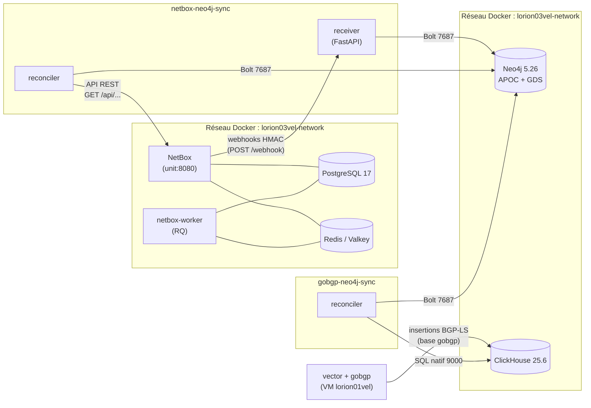

# Documentation de la plateforme Orion

Bienvenue sur le portail de documentation de la plateforme **Orion**.

Cette plateforme fournit une **représentation en graphe de l'infrastructure réseau**,
alimentée par deux sources de vérité : **NetBox** (DCIM) et le **réseau vivant** via
**BGP-LS** (collecte gobgp sur `lorion01vel`, transit par la base analytique
**ClickHouse**). Les deux sont synchronisées vers **Neo4j** pour être exploitées en
parcours de graphe et algorithmes GDS.

!!! info "Portée de cette documentation"
    Cette documentation décrit **uniquement l'implémentation réelle** du dépôt
    `orion-lab-stack` (stacks `lorion01vel` et `lorion03vel` : fichiers Compose,
    Dockerfiles, `.env`, XML, scripts, code Python). Les technologies prévues mais non
    encore déployées (gnmic, Kafka, Traefik, authentification centralisée) sont listées
    dans la page [Roadmap](architecture/roadmap.md).

## Services

-   :material-graph-outline:{ .lg .middle } **Neo4j** &nbsp;actif

    ---

    Base orientée graphe (5.26.0) avec plugins **APOC** et **Graph Data Science**.
    Stocke les devices et leurs interconnexions.

    [:octicons-arrow-right-24: Documentation Neo4j](services/neo4j/index.md)

-   :material-database-search:{ .lg .middle } **ClickHouse** &nbsp;actif

    ---

    Base analytique OLAP (25.6). Reçoit les données **BGP-LS** collectées sur
    `lorion01vel` (gobgp + vector) et sert de source au sync gobgp → Neo4j.

    [:octicons-arrow-right-24: Documentation ClickHouse](services/clickhouse/index.md)

-   :material-sync:{ .lg .middle } **netbox-neo4j-sync** &nbsp;actif

    ---

    Application Python : **receiver** FastAPI (webhooks temps réel), **reconciler**
    périodique et **CLI** d'administration.

    [:octicons-arrow-right-24: Documentation du sync](services/netbox-neo4j-sync/index.md)

-   :material-sync:{ .lg .middle } **gobgp-neo4j-sync** &nbsp;actif

    ---

    Reconciler Python : projette la **topologie BGP-LS** (base `gobgp` de ClickHouse)
    dans le graphe Neo4j (deux boucles : topologie périodique + monitor incrémental).

    [:octicons-arrow-right-24: Documentation du sync](services/gobgp-neo4j-sync/index.md)

-   :material-router:{ .lg .middle } **gobgp** &nbsp;actif

    ---

    Collecte **BGP-LS** conteneurisée sur `lorion01vel` : daemon GoBGP v4.1.0 +
    client d'extraction (snapshots horaires et flux d'événements → CSV).

    [:octicons-arrow-right-24: Documentation gobgp](services/gobgp/index.md)

-   :material-pipe:{ .lg .middle } **vector** &nbsp;actif

    ---

    Pipeline temps réel sur `lorion01vel` : taille les CSV d'événements BGP et les
    insère dans ClickHouse (tables `monitor_bgp_*`).

    [:octicons-arrow-right-24: Documentation vector](services/vector/index.md)

-   :material-server-network:{ .lg .middle } **NetBox** &nbsp;externe

    ---

    Source de vérité DCIM (v4.5.4) et ses dépendances : PostgreSQL, Redis/Valkey, worker RQ.

    [:octicons-arrow-right-24: Documentation NetBox](services/netbox/index.md)

## Vue d'ensemble de la plateforme

## Par où commencer ?

-   :material-sitemap: **Comprendre l'architecture**

    ---

    [Vue générale](architecture/overview.md) · [Réseau](architecture/networking.md) ·
    [Flux de données](architecture/data-flow.md) · [Sécurité](architecture/security.md)

-   :material-rocket-launch: **Déployer la plateforme**

    ---

    [Déploiement complet](operations/deployment.md) ·
    [Runbook d'exploitation](operations/runbook.md)

-   :material-lifebuoy: **Exploiter au quotidien**

    ---

    [Monitoring](monitoring/index.md) · [Sauvegarde & restauration](operations/backup-restore.md) ·
    [Troubleshooting](troubleshooting/index.md) · [FAQ](faq/index.md)

## Conventions

| Badge | Signification |
|-------|---------------|
| actif | Service déployé et en fonctionnement |
| désactivé | Défini/configuré mais non démarré |
| externe | Déployé hors de ce dépôt (`/home/services/…`) |
| planifié | Prévu (cf. [Roadmap](architecture/roadmap.md)), non implémenté |
