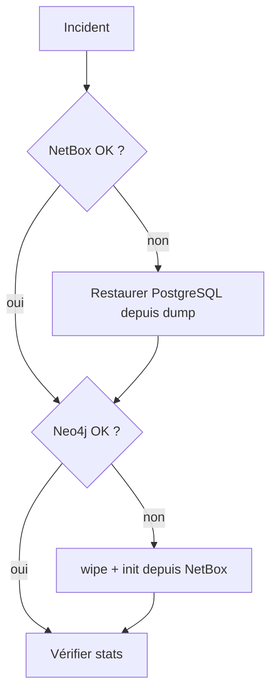

# Sauvegarde & restauration

## Que sauvegarder ?

| Donnée | Volume | Criticité | Reconstruction |
|--------|--------|-----------|----------------|
| **NetBox** (source de vérité) | `netbox-postgres-data` | **Critique** | Impossible à régénérer |
| **ClickHouse** (base `gobgp`) | `lorion03vel_clickhouse_data` | **Historique BGP** | L'état courant se recollecte ; l'**historique des événements** (`monitor_bgp_*`) est perdu sans sauvegarde |
| **Neo4j** (graphe) | `lorion03vel_neo4j_data` | Rejouable | `admin init` (NetBox) + cycle topologie (BGP-LS) |
| Checkpoints vector | `lorion01vel_vector_data` | Faible | Perte = ré-ingestion des CSV (doublons transitoires) |
| CSV gobgp | `lorion01vel/gobgp/data/` | Faible | Regénérés par la collecte (snapshots) |
| Secrets / `.env` | fichiers `secrets/`, `.env` | **Critique** | À sauvegarder hors git |

!!! tip "Priorité"
    La base **NetBox/PostgreSQL** est irremplaçable, et l'**historique BGP** de ClickHouse
    ne se recollecte pas : ce sont les deux sauvegardes qui comptent. Le graphe Neo4j, lui,
    peut être **entièrement reconstruit** depuis ses sources (`admin init` + cycles).

## NetBox / PostgreSQL

```bash
# Sauvegarde (dump logique)
docker exec netbox-docker-postgres-1 pg_dump -U <user> <db> > netbox_$(date +%F).sql

# Restauration
cat netbox_<date>.sql | docker exec -i netbox-docker-postgres-1 psql -U <user> -d <db>
```

## Neo4j

Voir [Neo4j / Maintenance](../services/neo4j/maintenance.md). Rappel :

```bash
docker compose stop neo4j
docker run --rm -v lorion03vel_neo4j_data:/data -v "$PWD":/backup \
  registry.example.com/dockerhub/neo4j:5.26.0 \
  neo4j-admin database dump neo4j --to-path=/backup
docker compose start neo4j
```

Alternative rapide (rejouer depuis la source) :

```bash
docker compose run --rm reconciler python -m admin wipe --yes
docker compose run --rm reconciler python -m admin init
```

## ClickHouse

Voir [ClickHouse / Maintenance](../services/clickhouse/maintenance.md) (copie de volume ou export
logique `FORMAT Native`).

## Secrets & configuration

!!! danger "Ne pas oublier les secrets"
    Sauvegarder **hors dépôt** (coffre) :
    ```
    lorion03vel/neo4j/secrets/neo4j_auth
    lorion03vel/clickhouse/secrets/*
    lorion03vel/netbox-neo4j-sync/.env
    lorion03vel/gobgp-neo4j-sync/.env + secrets/ch_gobgp_reader_password
    lorion01vel/gobgp/secrets/ch_gobgp_password
    deploy/hosts.env
    /home/services/netbox-docker/env/*.env
    ```

## Reprise après incident (résumé)



1. Restaurer NetBox/PostgreSQL si nécessaire (source de vérité).
2. Reconstruire Neo4j : `admin wipe --yes` puis `admin init` (ou restaurer un dump).
3. Vérifier : `admin stats`, healthchecks, webhooks.
