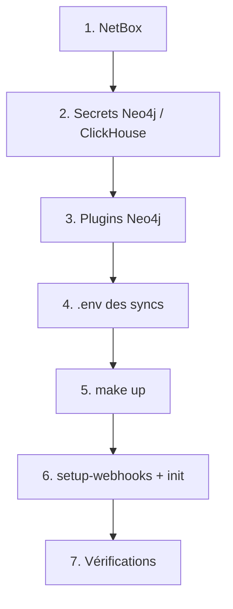

# Déploiement complet

Procédure de mise en route de la plateforme, de zéro à opérationnel.

## Prérequis

- Docker + Docker Compose v2 sur chaque VM.
- Accès au miroir `registry.example.com` et au proxy `<https_proxy_addr>:<port>` (build).
- NetBox déployé (`/home/services/netbox-docker`).

## Vue d'ensemble multi-VM

Le dépôt contient **une stack par VM** (`lorion01vel/`, `lorion03vel/`), chacune pilotée
par un Makefile qui inclut les cibles communes de `common.mk` (racine du dépôt) :

| Cible | Effet |
|-------|-------|
| `make up` | crée le réseau partagé de la VM (si absent) + `docker compose up -d --build` |
| `make down` | arrête la stack (le réseau partagé reste) |
| `make purge` | `down` + suppression du réseau |
| `make ps` | état des services |

!!! warning "Réseaux Docker : jamais à la main"
    Les réseaux `lorionXXvel-network` sont `external: true` : leur cycle de vie est géré
    par `make up` / `make purge`, **pas** par `docker network create` manuel.

### Déployer depuis le poste d'administration

Le script `deploy/deploy.sh` pousse le code vers une VM (rsync) puis y exécute `make up` :

```bash
cp deploy/hosts.env.example deploy/hosts.env   # renseigner les IP SSH (une fois)
make deploy VM=lorion03vel        # une VM (rsync + make up)
make deploy-all                   # toutes les VMs
make down VM=lorion03vel          # arrêt d'une stack (réseau conservé)
make down-all                     # arrêt de toutes les stacks
make status                       # make ps partout
make status VM=lorion03vel        # make ps sur une seule VM
```

Seul `deploy` pousse le code ; `down` et `status` sont de pures commandes de contrôle
à distance.

- `deploy/hosts.env` (non versionné) associe chaque VM à sa destination SSH ;
  la valeur `local` court-circuite SSH pour la VM qui héberge le dépôt.
- Par défaut, `.env` et `secrets/` **ne sont pas poussés** (ceux de la VM font foi) ;
  ajouter `SECRETS=1` pour les inclure.
- `data/` et `logs/` (artefacts d'exécution) ne sont jamais poussés.

!!! info "Déploiement à plusieurs"
    Avec `DEPLOY_HOST_<vm>=$USER@...`, chacun déploie sous **son** compte : les fichiers
    distants appartiennent au **dernier déployeur**. Trois conditions rendent cela sûr :
    tous les déployeurs sont dans le groupe **`ops`** ; l'arbre distant est
    `g+rwX` + dossiers **setgid** (préparation faite une fois par VM) ; et `deploy.sh`
    pousse en `--chmod=Dg+rwxs,Fg+rw` + `-O` pour entretenir ces droits. Symptôme d'une
    VM non préparée : `rsync … Permission denied (13)` / `failed to set times` — rejouer
    alors sur la VM :
    ```bash
    chmod -R g+rwX /data/orion-lab-stack
    find /data/orion-lab-stack -type d -exec chmod g+s {} +
    ```

### Démarrage au boot

Sur chaque VM, installer l'unit template `deploy/systemd/orion-stack@.service` :

```bash
sudo cp deploy/systemd/orion-stack@.service /etc/systemd/system/
sudo systemctl daemon-reload
sudo systemctl enable --now orion-stack@lorion03vel   # ou @lorion01vel
```

## Étapes (première installation de lorion03vel)



### 1. NetBox

```bash
cd /home/services/netbox-docker
docker compose up -d
docker compose ps          # netbox healthy, worker, postgres, redis, redis-cache
```

### 2. Secrets

```bash
cd ~/autoCOREBIB/orion-lab-stack/lorion03vel
# Neo4j : neo4j/<motdepasse>
printf 'neo4j/lorion03vel_neo4j' > neo4j/secrets/neo4j_auth
# ClickHouse : alignés aux hashs XML — voir ClickHouse / Déploiement
```

### 3. Plugins Neo4j (hors-ligne)

Voir [Neo4j / Déploiement](../services/neo4j/deployment.md) — JARs APOC 5.26.x + GDS 2.13.x dans
`neo4j/plugins/`.

### 4. Configuration des syncs

```bash
cd netbox-neo4j-sync
cp .env.example .env
# Renseigner : NETBOX_TOKEN, WEBHOOK_SECRET (fort), NEO4J_PASSWORD, BUILD_*_PROXY

cd ../gobgp-neo4j-sync
cp .env.example .env
# Renseigner : CLICKHOUSE_PASSWORD (gobgp_reader), NEO4J_PASSWORD
# CLICKHOUSE_HOST reste lorion03vel-clickhouse (conteneur local, jamais l'IP hôte)
```

### 5. Démarrage de la stack lorion03vel

```bash
cd ~/autoCOREBIB/orion-lab-stack/lorion03vel
make up            # réseau + build + up -d (ClickHouse, Neo4j, syncs)
make ps
```

### 6. Intégration NetBox + bootstrap

```bash
docker compose run --rm reconciler python -m admin setup-webhooks
docker compose run --rm reconciler python -m admin init
```

### 7. Vérifications

```bash
make ps                                             # tout Up (healthy)
docker compose run --rm reconciler python -m admin stats
docker compose logs reconciler | grep "Cycle terminé"
docker compose logs reconciler-gobgp-neo4j | tail   # cycles topologie + monitor
```

!!! success "Plateforme opérationnelle"
    - Neo4j `healthy`, plugins APOC/GDS chargés ; ClickHouse `healthy`.
    - receiver `healthy`, reconcilers en cycles réguliers.
    - Webhooks NetBox → receiver en `200`.

## Stack lorion01vel (collecte BGP-LS)

```bash
# via le poste d'admin :
make deploy VM=lorion01vel
# ou sur la VM :
cd ~/autoCOREBIB/orion-lab-stack/lorion01vel && make up
```

Le conteneur gobgpd écoute sur **1790 (BGP)** et **50052 (gRPC)** — le gobgpd systemd de
prod conserve 179/50051 sur l'hôte. Vector lit les CSV de `gobgp/data/` et insère dans la
base `gobgp` de ClickHouse (lorion03vel).
