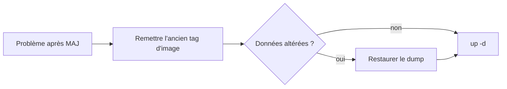

# Mises à jour & rollback

## Principes

!!! abstract "Règles d'or"
    - **Sauvegarder avant** toute montée de version (voir [Sauvegarde](backup-restore.md)).
    - Mettre à jour **un service à la fois** et vérifier.
    - Respecter les **compatibilités de version** (surtout Neo4j ↔ APOC ↔ GDS).

## Neo4j

1. Modifier `IMAGE_NEO4J` dans `neo4j/.env`.
2. Télécharger les **JARs APOC/GDS compatibles** (même mineure ; GDS en Java 17 pour 5.26).
3. Recréer :
   ```bash
   docker compose pull neo4j && docker compose up -d neo4j
   docker exec lorion03vel-neo4j cypher-shell -u neo4j -p '<mdp>' \
     "RETURN apoc.version(), gds.version();"
   ```

!!! danger "Java 17 vs 21"
    Neo4j 5.26 = Java 17. GDS ≥ 2.27 (Java 21) est **incompatible**
    (`UnsupportedClassVersionError`). Rester sur GDS 2.13.x.

## Images buildées (syncs, gobgp, docs)

Les images construites dans ce dépôt suivent la convention
**`orion/<service>:${IMAGE_TAG:-0.1.0}`**. Pour une évolution traçable :

```bash
# 1. bump du tag dans le .env de la stack concernée
echo "IMAGE_TAG=0.2.0" >> .env         # (ou éditer la valeur existante)
# 2. rebuild + recréation
make up                                 # depuis le dossier de la VM
```

L'ancienne image (`orion/…:0.1.0`) **reste en cache local** : le rollback consiste à
remettre l'ancien `IMAGE_TAG` puis `make up` — aucun rebuild nécessaire.

## netbox-neo4j-sync

Après toute modification de code ou de version d'image :

```bash
docker compose build receiver reconciler
docker compose up -d receiver reconciler
docker compose run --rm reconciler python -m admin init   # re-sync
```

## ClickHouse

```bash
# adapter le tag dans clickhouse/compose.yml
docker compose pull clickhouse && docker compose up -d clickhouse
docker exec lorion03vel-clickhouse wget -qO- http://127.0.0.1:8123/ping
```

## NetBox

Géré par netbox-docker (mettre à jour `VERSION`, reconstruire l'image `-plugins`). Consulter la
documentation netbox-docker. **Toujours** dumper PostgreSQL avant.

## Rollback



| Service | Rollback |
|---------|----------|
| Neo4j | Ancien `IMAGE_NEO4J` + anciens JARs `plugins/` ; restaurer dump si besoin |
| sync | Rebuild depuis le code précédent ; `admin init` |
| ClickHouse | Ancien tag ; restaurer volume si besoin |
| NetBox | Ancien `VERSION` ; restaurer dump PostgreSQL |

## Procédure type (checklist)

- [ ] Sauvegarde effectuée (volume/dump + secrets)
- [ ] Compatibilités vérifiées (Neo4j/APOC/GDS)
- [ ] MAJ d'un service, `up -d`
- [ ] Healthcheck `healthy`
- [ ] Vérification fonctionnelle (`admin stats`, requête test, webhook test)
- [ ] En cas d'échec : rollback (tag + éventuel dump)
