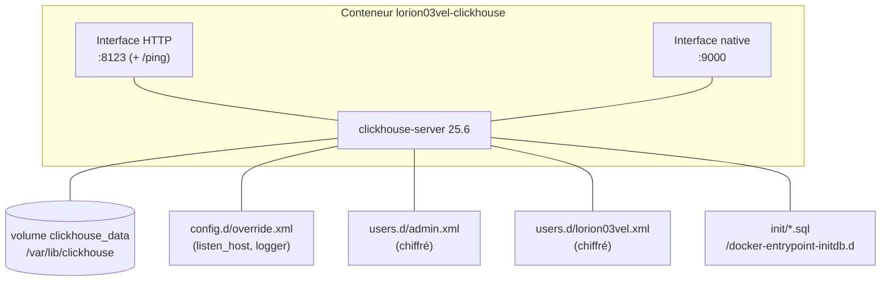
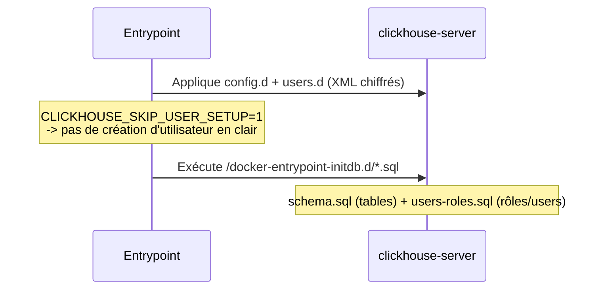

# ClickHouse — Architecture

## Composants internes

## Ports

| Port | Interface | Usage |
|------|-----------|-------|
| 8123 | HTTP | Requêtes HTTP, endpoint `/ping` (healthcheck) |
| 9000 | Natif | `clickhouse-client`, drivers natifs |

## Réseau Docker

- Attaché à **`lorion03vel-network`** (`external: true`).
- Nom interne : `lorion03vel-clickhouse`.

!!! info "listen_host rétabli explicitement"
    En montant `./config/config.d` sur `/etc/clickhouse-server/config.d`, on **masque** le
    `docker_related_config.xml` de l'image (qui ouvrait l'écoute réseau). `override.xml` rétablit
    donc `<listen_host>0.0.0.0</listen_host>`, sinon ClickHouse n'écouterait que sur le loopback
    et le mapping de ports renverrait « Connection reset by peer ».

## Volumes & montages

| Montage | Cible | Rôle |
|---------|-------|------|
| `clickhouse_data` (nommé) | `/var/lib/clickhouse` | Données persistantes |
| `./config/config.d` (ro) | `/etc/clickhouse-server/config.d` | Surcharges de config (fusionnées) |
| `./config/users.d/admin.xml` (ro) | `…/users.d/admin.xml` | Utilisateur admin (chiffré) |
| `./config/users.d/lorion03vel.xml` (ro) | `…/users.d/lorion03vel.xml` | Utilisateur applicatif (chiffré) |
| `./init` (ro) | `/docker-entrypoint-initdb.d` | Scripts SQL d'init (1er démarrage) |

!!! note "Montage de fichiers unitaires pour users.d"
    Les fichiers `admin.xml` et `lorion03vel.xml` sont montés **individuellement** (pas le
    dossier `users.d`) pour ne pas masquer le `default-user.xml` généré par l'entrypoint.

## Bases de données hébergées

| Base | Créée par | Contenu | Producteurs / consommateurs |
|------|-----------|---------|------------------------------|
| `gobgp` | `lorion01vel/gobgp/schemas/00_setup.sql` (exécuté une fois par un admin) | 15 tables BGP-LS : `bgp_ls_*`, `SAFI_*` (snapshots, `ReplacingMergeTree(Age)`) + `monitor_bgp_*` (événements) | écrite par vector + `load_clickhouse.sh` (`gobgp_writer`), lue par `gobgp-neo4j-sync` (`gobgp_reader`) |
| `lorion03vel` | `CLICKHOUSE_DB` (entrypoint) | *(vide)* | — |
| `mydb` | `init/schema.sql` (1er démarrage) | Tables d'**exemple** (`events`, `metrics`, vue agrégée) | — |

## Protocoles & communications

| Sens | Protocole | Détail |
|------|-----------|--------|
| Entrant | HTTP (8123) | Requêtes SQL, `/ping` ; **insertions vector** (inter-VM) |
| Entrant | Natif (9000) | `clickhouse-client`, `gobgp-neo4j-sync`, `load_clickhouse.sh` (inter-VM) |
| Sortant | *(aucun)* | ClickHouse n'appelle aucun service externe |

## Séquence d'initialisation (1er démarrage)

