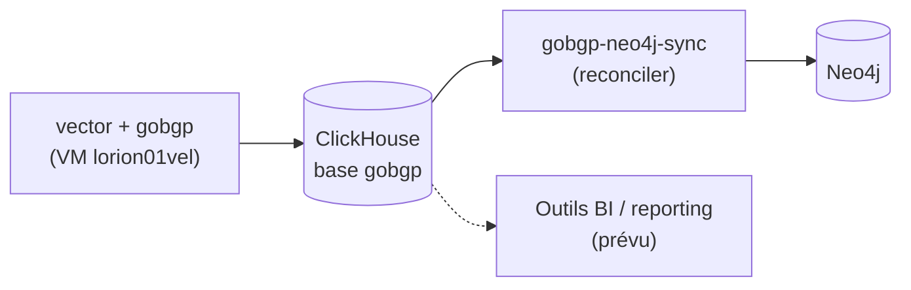

# ClickHouse — Vue d'ensemble

actif — Base analytique OLAP, incluse dans le Compose parent.

## Présentation

**ClickHouse 25.6** (alpine) est la base de données **analytique colonne** (OLAP) de la
plateforme. Elle est **entièrement définie et configurée** dans le dépôt (compose, utilisateurs
XML chiffrés, scripts d'init SQL, script de gestion des utilisateurs) et **incluse dans
l'`include`** du Compose parent : elle démarre avec la stack (`make up`).

| Attribut | Valeur réelle |
|----------|---------------|
| Image | `${REGISTRY}/clickhouse/clickhouse-server:25.6-alpine` (miroir interne) |
| Conteneur | `lorion03vel-clickhouse` |
| Statut | **Actif** (inclus dans `docker-compose.yml`) |
| Réseau | `lorion03vel-network` |
| Ports | 8123 (HTTP), 9000 (natif) |

!!! tip "Accès depuis les conteneurs de la même VM"
    Depuis un conteneur du réseau `lorion03vel-network`, toujours utiliser le nom
    **`lorion03vel-clickhouse:9000`** — jamais l'IP de l'hôte (`10.10.3.141`) : le
    hairpin NAT est bloqué sur cette infra.

## Rôle dans l'architecture

ClickHouse héberge la base **`gobgp`** : les données **BGP-LS** collectées sur la VM
`lorion01vel` (gobgp → CSV → vector) y sont insérées en continu, puis lues par le
reconciler `gobgp-neo4j-sync` qui les projette dans Neo4j. Les tables `events` /
`metrics` du schéma d'init restent un **schéma d'exemple**.

## Pourquoi ClickHouse

!!! question "Justification du choix"
    ClickHouse est un moteur **colonne** conçu pour l'**analytique à fort volume** : agrégations
    rapides, compression élevée, vues matérialisées, TTL de données. Il complète Neo4j (parcours
    de graphe) pour les besoins **OLAP** (comptages, séries temporelles) où une base graphe ou
    relationnelle serait moins adaptée.

## Alternatives étudiées

| Alternative | Pourquoi écartée (pour l'OLAP) |
|-------------|-------------------------------|
| PostgreSQL | Orienté OLTP ; moins performant sur agrégations massives |
| Neo4j | Base graphe, non adaptée aux requêtes analytiques colonnes |
| Elasticsearch | Orienté recherche/logs, moins efficace pour l'agrégation SQL analytique |

## Avantages / Inconvénients

!!! success "Avantages"
    - Requêtes analytiques très rapides (moteur `MergeTree`).
    - Vues matérialisées, TTL, partitionnement natifs.
    - Gestion fine des utilisateurs/rôles/quotas SQL.

!!! warning "Inconvénients / limites"
    - Non transactionnel (pas d'OLTP).
    - Schéma d'init (`events`, `metrics`) = **exemple** à remplacer par le modèle métier réel
      (la base réellement exploitée est `gobgp`).

## Dépendances & interactions

| Type | Détail |
|------|--------|
| **Dépendances** | Réseau `lorion03vel-network`, secret `clickhouse_password` |
| **Services consommateurs** | `gobgp-neo4j-sync` (lecture base `gobgp`, natif 9000) — prévu : outils BI / reporting |
| **Services producteurs** | `vector` (VM `lorion01vel`, insertions BGP-LS) |
| **Flux entrants** | HTTP 8123 / natif 9000 (requêtes SQL) |
| **Flux sortants** | *(aucun)* |

## Pages détaillées

[Architecture](architecture.md) · [Configuration](configuration.md) · [Sécurité](security.md) ·
[Déploiement](deployment.md) · [Maintenance](maintenance.md) · [Monitoring](monitoring.md) ·
[Dépannage](troubleshooting.md)
