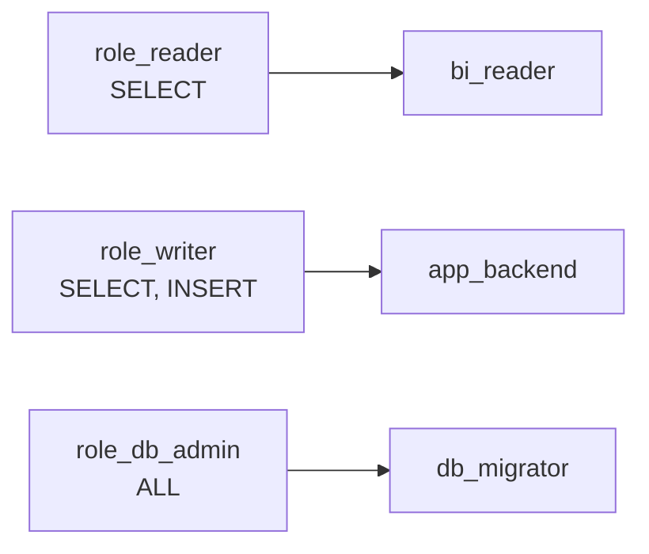

# ClickHouse — Sécurité

## Modèle d'authentification

Les comptes sensibles sont **définis en XML avec mot de passe chiffré** (`password_sha256_hex`),
et l'accès anonyme est supprimé.

| Compte | Défini dans | Particularités |
|--------|-------------|----------------|
| `admin` | `users.d/admin.xml` | `access_management=1` — gère les autres utilisateurs via `manage-users.sh` |
| `lorion03vel` | `users.d/lorion03vel.xml` | Applicatif ; `access_management=1` (init DDL) |
| `default` | *(supprimé)* | `<default remove="remove"/>` — plus d'accès anonyme |

!!! success "Pourquoi XML chiffré plutôt que variables d'env"
    Créer l'utilisateur via `CLICKHOUSE_USER`/`CLICKHOUSE_PASSWORD` stockait le mot de passe **en
    clair**. Ici `CLICKHOUSE_SKIP_USER_SETUP=1` désactive ce comportement : les comptes viennent
    des XML (`password_sha256_hex`), et `default` est retiré.

## Gestion des secrets

| Secret | Emplacement | Consommateur |
|--------|-------------|--------------|
| `clickhouse_password` | `secrets/clickhouse_password` → `/run/secrets/…` | Entrypoint (init en tant que `lorion03vel`) |
| `clickhouse_admin_password` | `secrets/clickhouse_admin_password` (hôte) | `manage-users.sh` uniquement |

- Le dossier `secrets/` est **exclu du versionnement** (`.gitignore`).
- Le contenu de chaque secret doit **correspondre** au `password_sha256_hex` du XML associé.

## Autorisation — rôles & utilisateurs SQL

Définis à l'init (`init/users-roles.sql`) :

| Rôle | Droits sur `mydb` | Utilisateur par défaut |
|------|-------------------|------------------------|
| `role_reader` | `SELECT` | `bi_reader` |
| `role_writer` | `SELECT, INSERT` | `app_backend` |
| `role_db_admin` | `ALL` (DDL inclus) | `db_migrator` |

Un **quota** `quota_readonly` limite `bi_reader` à 100 requêtes/heure.

S'y ajoutent les rôles de la base **`gobgp`** (créés hors init, par
`lorion01vel/gobgp/schemas/*.sql`) — principe de **moindre privilège par usage** :

| Rôle | Droits sur `gobgp` | Utilisateur | Utilisé par |
|------|--------------------|-------------|-------------|
| `role_gobgp_writer` | `SELECT, INSERT` | `gobgp_writer` | vector, `load_clickhouse.sh` |
| `role_gobgp_reader` | `SELECT` | `gobgp_reader` | `gobgp-neo4j-sync` |

!!! danger "Mots de passe d'exemple en clair dans le SQL"
    `users-roles.sql` crée `app_backend`, `bi_reader`, `db_migrator` avec des mots de passe
    **en clair** dans le script (`IDENTIFIED WITH sha256_password BY '…2024!'`). C'est du contenu
    **d'exemple** : à remplacer par des valeurs propres (idéalement hachées) avant tout usage réel.

## Réseau & isolation

- `<networks>` des utilisateurs XML : `::/0` et `0.0.0.0/0` (accès depuis tout le réseau Docker).
- Attaché au seul réseau `lorion03vel-network`.
- Pas d'accès Internet sortant.

## TLS / reverse proxy

!!! warning "Absents"
    Pas de TLS ni de reverse proxy. Les ports 8123/9000 sont exposés directement sur l'hôte
    (lorsque le service est activé).

## Gestion dynamique des comptes : `manage-users.sh`

Script **hôte** qui exécute les requêtes via `docker exec` + client natif (évite l'interface
HTTP et le proxy). Il lit le secret admin et permet de créer/supprimer/gérer des utilisateurs
SQL sans écrire de mot de passe en clair dans les fichiers versionnés. Voir
[Maintenance](maintenance.md).
