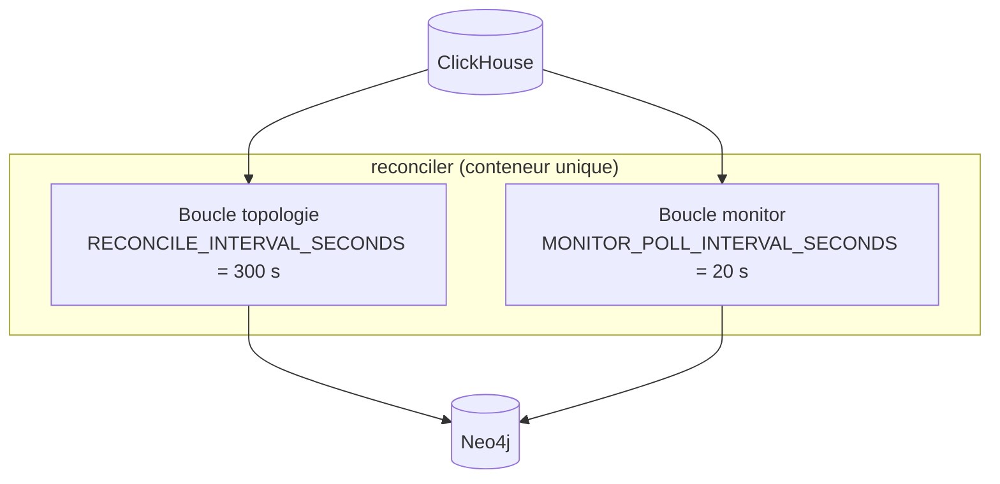

# gobgp-neo4j-sync — Architecture

Un **seul conteneur**, deux boucles internes threadées, arrêt propre sur SIGTERM
(fin du cycle en cours puis sortie).



## Boucle topologie (état complet, 5 min)

À chaque cycle, lecture **complète** des tables d'état (avec `FINAL` : les tables sont
en `ReplacingMergeTree`, `FINAL` force la déduplication à la lecture) :

1. **Routeurs** — fusion `bgp_ls_nodes` (base) + `SAFI_LINK_STATE_NODE` (overlay plus
   riche), puis pose des **propriétés BGP sur l'équipement NetBox homonyme** (match
   insensible à la casse sur `Nom`). Les routeurs sans nom ou absents de NetBox sont
   comptés `sans équipement correspondant`.
2. **Préfixes** — fusion `bgp_ls_prefixV4/V6` + `SAFI_LINK_STATE_PREFIXE_V4/V6` :
   upsert des nœuds `:Prefix` et des relations `ANNOUNCES_PREFIX`.
3. **Liens** — `bgp_ls_links` **uniquement** : upsert des relations `ISIS`.
4. **Purge** — les préfixes, annonces et liens non revus dans ce cycle sont supprimés
   (`prune_*`) : le graphe converge vers l'état ClickHouse.

Chaque cycle se conclut par une ligne de log bilan :

```text
Cycle topologie terminé : 21/31 routeur(s) rattachés à un équipement, 563 préfixe(s),
611/676 annonce(s) IGP, 74/102 lien(s) ; 10 routeur(s), 65 annonce(s), 28 lien(s)
sans équipement correspondant.
```

## Boucle monitor (fraîcheur, 20 s)

Lit les tables d'événements `monitor_bgp_*` sur une **fenêtre glissante**
(`Age > now() - MONITOR_WINDOW_SECONDS`, calculée **côté serveur** ClickHouse pour
éviter tout écart d'horloge) :

- `monitor_bgp_ls_node` / `monitor_bgp_ls_link` / `monitor_bgp_ls_prefixev4/v6` :
  met à jour `Withdraw` / `LastEventAge` sur les éléments **existants** — un événement
  monitor ne **crée jamais** de lien ni de nœud.
- `monitor_bgp_ipv4unicast` / `monitor_bgp_lu` / `monitor_bgp_vpn` : upsert des
  relations `ANNOUNCES_ROUTE` (routes BGP classiques).

!!! note "Fenêtre > intervalle"
    `MONITOR_WINDOW_SECONDS` (120 s) > `MONITOR_POLL_INTERVAL_SECONDS` (20 s) : un cycle
    en retard ne perd pas d'événements — les écritures étant idempotentes, relire une
    fenêtre déjà traitée est sans effet.

## Cartes de résolution (reconstruites à chaque cycle)

Les identifiants BGP-LS (`IgpRouterId`, `RouterId`) doivent être résolus en **nom
d'équipement NetBox**. Trois cartes sont reconstruites à chaque cycle monitor depuis les
tables d'état :

| Carte | Construite depuis |
|-------|-------------------|
| `IgpRouterId → nom` | `bgp_ls_nodes` + `SAFI_LINK_STATE_NODE` |
| `RouterId → nom` | `SAFI_LINK_STATE_NODE` |
| `RouterId → IgpRouterId` | `SAFI_LINK_STATE_NODE` + paires réelles de `bgp_ls_links` |

!!! info "Pourquoi reconstruire à chaque cycle ?"
    Les nœuds équipement sont **réécrits par netbox-neo4j-sync** (`SET n = $props`) : on
    ne peut pas y stocker durablement les identifiants BGP-LS. La résolution vit donc
    côté reconciler, pas dans le graphe.

## Idempotence & cohabitation

Toutes les écritures sont des `MERGE` : les deux boucles et `netbox-neo4j-sync`
cohabitent sans verrou. Convention de partage : **l'état durable BGP vit sur les
relations** (`ISIS`, `ANNOUNCES_*`), les propriétés BGP posées sur les nœuds équipement
sont volatiles (voir [Modèle de données](data-model.md)).
