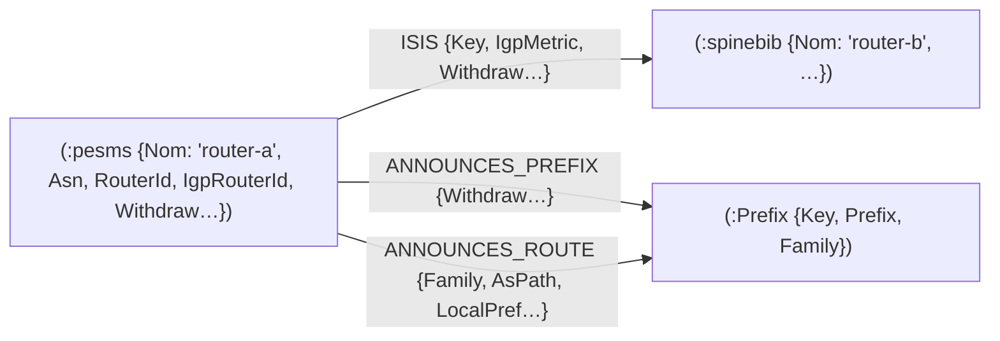

# gobgp-neo4j-sync — Modèle de données

## Principe : aucune duplication des équipements

**Aucun nœud routeur n'est créé.** Chaque routeur BGP-LS est rattaché au nœud équipement
NetBox **homonyme** (match insensible à la casse sur `Nom`). Les routeurs sans nom ou
absents de NetBox sont ignorés (compteurs dans les logs de cycle).



## Nœuds

| Nœud | Propriétés | Source | Remarques |
|------|-----------|--------|-----------|
| `(:Prefix)` | `Key` (= `"<Family>\|<Prefix>"`), `Prefix`, `Family` | tables préfixes | **Seuls nœuds appartenant à cette synchro** |
| équipements (`:pesms`, `:spinebib`, …) | + `Asn`, `RouterId`, `IgpRouterId`, `Withdraw`, … | tables nœuds | Nœuds **créés par netbox-neo4j-sync** ; les props BGP posées ici sont **volatiles** (réécrites par le sync NetBox) |

!!! warning "État durable = relations"
    `netbox-neo4j-sync` réécrit intégralement les propriétés des nœuds équipement
    (`SET n = $props`). Toute donnée BGP devant survivre vit donc **sur les relations**,
    jamais sur les nœuds.

## Relations

| Relation | De → vers | Clé | Source | Créée par |
|----------|-----------|-----|--------|-----------|
| `ISIS` | équipement → équipement | `Key` = `LocalIgpRouterId\|RemoteIgpRouterId` | `bgp_ls_links` **uniquement** | cycle topologie |
| `ANNOUNCES_PREFIX` | équipement → `:Prefix` | (équipement, préfixe) | `bgp_ls_prefixV4/V6`, `SAFI_LINK_STATE_PREFIXE_V4/V6` | cycle topologie |
| `ANNOUNCES_ROUTE` | équipement → `:Prefix` | (équipement, préfixe, `Family`) | `monitor_bgp_ipv4unicast` / `monitor_bgp_lu` / `monitor_bgp_vpn` | cycle monitor |

Détails :

- **`ISIS`** : porte `IgpMetric`, `Withdraw`, `LastEventAge`, … La clé utilise les
  **IgpRouterId** (les `RouterId` loopback sont parfois vides dans `bgp_ls_links`).
  Les événements `monitor_bgp_ls_link` **ne créent jamais de lien** : ils posent
  `Withdraw`/`LastEventAge` sur le lien existant, leurs `RouterId` étant résolus en
  `IgpRouterId` via les cartes de résolution.
- **`ANNOUNCES_ROUTE`** : `Family` ∈ `ipv4unicast` / `labeled_unicast` / `vpn` ; porte
  `AsPath`, `LocalPref`, `Med`, `Withdraw`, … L'équipement est retrouvé via
  `OriginatorId` (= `RouterId` BGP-LS) → nom. Si `OriginatorId` ne correspond à aucun
  équipement connu, la ligne est **ignorée** (compteur `ignorée(s)` dans les logs).

## Purge et convergence

Le cycle topologie **purge** ce qu'il n'a pas revu : relations `ISIS` et
`ANNOUNCES_PREFIX` obsolètes, nœuds `:Prefix` orphelins. Le graphe converge donc vers
l'état des tables ClickHouse à chaque cycle (ClickHouse = source de vérité BGP).

## Requêtes de vérification

```cypher
-- Adjacences IGP
MATCH (a)-[l:ISIS]->(b) RETURN a.Nom, b.Nom, l.IgpMetric, l.Withdraw LIMIT 10;

-- Préfixes annoncés (IGP)
MATCH (n)-[:ANNOUNCES_PREFIX]->(p:Prefix) RETURN n.Nom, p.Prefix LIMIT 10;

-- Routes BGP par famille
MATCH (n)-[r:ANNOUNCES_ROUTE]->(p:Prefix)
RETURN r.Family, count(*) ORDER BY count(*) DESC;
```
