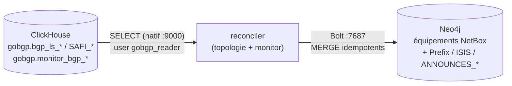

# gobgp-neo4j-sync — Vue d'ensemble

<span class="status status-active">actif</span> — Synchronisation de la topologie BGP-LS (ClickHouse) vers Neo4j.

## Présentation

`gobgp-neo4j-sync` est une application **Python** qui projette la topologie **BGP-LS**
collectée par gobgp (base ClickHouse `gobgp`) dans le graphe Neo4j, en la **greffant sur
les nœuds équipement déjà créés par `netbox-neo4j-sync`** : adjacences IGP, préfixes
annoncés, routes BGP.

| Composant | Rôle | Technologie |
|-----------|------|-------------|
| **reconciler** | Deux boucles : topologie (pull complet) + monitor (incrémental) | Python (threads) |
| **CLI admin** | `stats` / `init` / `wipe` | Python (`argparse`) |

| Attribut | Valeur réelle |
|----------|---------------|
| Image | `orion/gobgp-neo4j-sync-reconciler:0.1.0` (build local) |
| Conteneur | `gobgp-neo4j-sync-reconciler` |
| Réseau | `lorion03vel-network` |
| Sources | ClickHouse `lorion03vel-clickhouse:9000` (natif, user `gobgp_reader`) |
| Cible | Neo4j `bolt://lorion03vel-neo4j:7687` |

!!! warning "Toujours le réseau Docker, jamais l'IP hôte"
    Le service tourne sur la **même VM** que ClickHouse : il doit le joindre par le nom
    de conteneur `lorion03vel-clickhouse:9000`. L'IP hôte `10.10.3.141` échoue depuis un
    conteneur local (hairpin NAT bloqué).

## Rôle dans l'architecture



**Pas de receiver** : ClickHouse ne pousse rien — contrairement à NetBox et ses
webhooks, la seule stratégie possible est le **polling** (d'où la boucle monitor à
intervalle court).

## Pourquoi cette approche

!!! question "Justification"
    - **Greffe sur les équipements NetBox** plutôt que des nœuds routeur séparés : un
      seul nœud par équipement dans le graphe, les données DCIM et BGP se complètent.
    - **Deux boucles** : la topologie (5 min) porte l'état complet, le monitor (20 s)
      porte la fraîcheur (`Withdraw` en quasi temps réel) sans re-balayer les tables
      d'état.
    - **Utilisateur ClickHouse dédié en lecture seule** (`gobgp_reader`) : moindre
      privilège, `gobgp_writer` (SELECT+INSERT) reste réservé à la collecte.
    - **Fenêtre monitor calculée côté serveur** (`now()` ClickHouse) : aucun écart
      d'horloge possible entre le conteneur et la base.

## Dépendances & interactions

| Type | Détail |
|------|--------|
| **Dépendances** | ClickHouse (tables `gobgp.*` alimentées), Neo4j, équipements créés par `netbox-neo4j-sync` |
| **Services producteurs (sources)** | gobgp + vector + `load_clickhouse.sh` (via ClickHouse) |
| **Flux entrants** | *(aucun)* |
| **Flux sortants** | SQL natif `:9000`, Bolt `:7687` |

## Structure du code

```text
gobgp-neo4j-sync/
├── common/            # config (12-factor), logging, clients ClickHouse & Neo4j, mapping
├── reconciler/        # main.py : 2 boucles threadées (topologie / monitor)
├── admin/             # __main__.py : CLI stats / init / wipe
├── Dockerfile.reconciler
├── compose.yml        # 1 seul service
└── .env / .env.example / requirements.txt
```

## Pages détaillées

[Architecture](architecture.md) · [Modèle de données](data-model.md) ·
[Configuration](configuration.md) · [Déploiement](deployment.md) ·
[Dépannage](troubleshooting.md)
