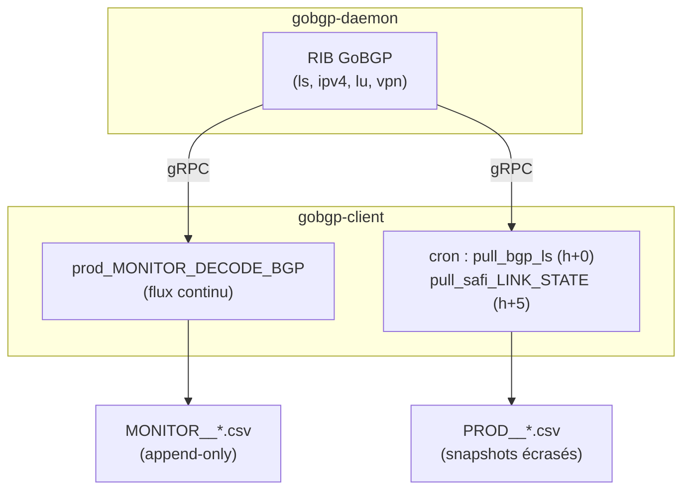

# gobgp — Architecture

## Les deux conteneurs

### gobgp-daemon (`gobgpd`)

Le daemon est un **binaire GoBGP v4.1.0 copié depuis la production** (pas d'installation
réseau : les conteneurs n'ont pas d'accès Internet). L'entrypoint lance :

```sh
exec /opt/gobgp/gobgpd \
    -f /opt/gobgp/gobgpd_all.conf \
    --api-hosts ":50051" \
    --log-plain \
    -l info
```

- **`gobgpd_all.conf`** : configuration TOML copiée de la prod — `router-id`
  `203.0.113.1`, sessions vers les réflecteurs (AS 64512), familles activées :
  `ls` (BGP-LS), `ipv4-unicast`, `ipv4-labelled-unicast`, `l3vpn-ipv4-unicast`.
- **gRPC sur 50051** *dans* le conteneur, publié en **50052** sur l'hôte.
- **Healthcheck** : `gobgp -u 127.0.0.1 -p 50051 global` toutes les 15 s — le client ne
  démarre que lorsque le daemon est `healthy` (`depends_on: condition: service_healthy`).
- **Logs** : driver `json-file` plafonné (10 Mo × 5 fichiers) + volume `./logs`.

### gobgp-client (`gobgp-cli`)

Conteneur permanent d'**extraction**. Son entrypoint lance deux mécanismes :

1. **`prod_MONITOR_DECODE_BGP`** (arrière-plan) : s'abonne au flux du daemon et écrit en
   continu les événements BGP dans les **`MONITOR__*.csv`** (append-only) ainsi que le
   dossier `flow-spec/`.
2. **`cron -f`** (premier plan) : exécute les snapshots horaires :

```text
0 * * * *  /opt/gobgp/bin/prod__pull_bgp_ls            # → PROD__pull_bgp_ls_*.csv
5 * * * *  /opt/gobgp/bin/prod__pull_safi_LINK_STATE   # → PROD__PULL_SAFI_LINK_STATE_*.csv
```

Les scripts (`prod__pull_bgp_ls`, `prod__pull_safi_LINK_STATE`, `prod_MONITOR_DECODE_BGP`)
sont montés depuis `./bin/bgpls` → `/opt/gobgp/bin` : ils se mettent à jour **sans
rebuild** de l'image.

## Vue d'ensemble des flux internes



Les deux familles de fichiers ont des **sémantiques différentes** — c'est ce qui justifie
les deux chemins de chargement vers ClickHouse (voir [Collecte](collecte.md)).

## Choix d'implémentation notables

!!! abstract "Décisions réellement appliquées"
    - **Pas de `network_mode: host`** (testé puis écarté) : le mode bridge + ports décalés
      suffit aux sessions BGP et isole le lab de la prod.
    - **`NO_PROXY`** inclut `gobgpd`, `gobgp-daemon`, `gobgp-client` : le proxy
      d'entreprise (variables de build) ne doit pas intercepter le trafic gRPC interne.
    - Le **chargement ClickHouse ne tourne pas dans le conteneur** : `clickhouse-client`
      n'y est pas installé (pas d'Internet) — il tourne côté hôte (cron), voir
      [Collecte](collecte.md).
