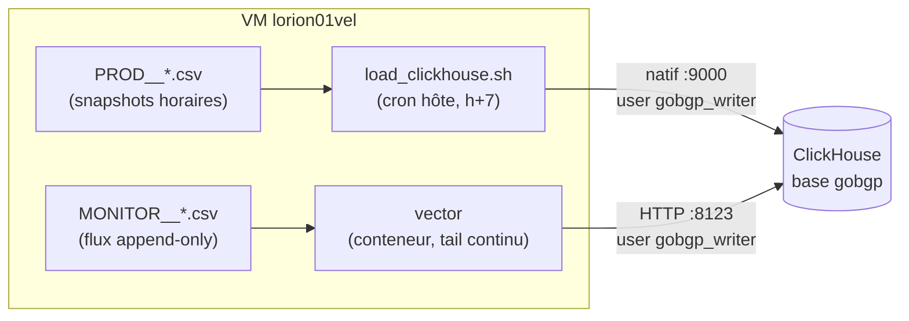

# gobgp — Collecte des données

Deux familles de CSV sont produites dans `./data`, avec deux chemins de chargement
distincts vers la base **`gobgp`** de ClickHouse (lorion03vel).

## Vue d'ensemble



## 1. Snapshots horaires — `PROD__*.csv` → cron hôte

Les scripts cron du conteneur (h+0 et h+5) **réécrivent** à chaque passage un instantané
complet de la RIB. Le chargement est fait **côté hôte** par
`scripts/load_clickhouse.sh`, planifié dans le crontab de l'hôte à **h+7** (après les
deux snapshots) :

```text
7 * * * * cd /data/orion-lab-stack/lorion01vel/gobgp && ./scripts/load_clickhouse.sh >> scripts/load_clickhouse.log 2>&1
```

| Fichier CSV | Table ClickHouse |
|-------------|------------------|
| `PROD__pull_bgp_ls_link.csv` | `gobgp.bgp_ls_links` |
| `PROD__pull_bgp_ls_node.csv` | `gobgp.bgp_ls_nodes` |
| `PROD__pull_bgp_ls_prefixV4.csv` | `gobgp.bgp_ls_prefixV4` |
| `PROD__pull_bgp_ls_prefixV6.csv` | `gobgp.bgp_ls_prefixV6` |
| `PROD__PULL_SAFI_LINK_STATE_LINK.csv` | `gobgp.SAFI_LINK_STATE_LINK` |
| `PROD__PULL_SAFI_LINK_STATE_NODE.csv` | `gobgp.SAFI_LINK_STATE_NODE` |
| `PROD__PULL_SAFI_LINK_STATE_PREFIXE_V4.csv` | `gobgp.SAFI_LINK_STATE_PREFIXE_V4` |
| `PROD__PULL_SAFI_LINK_STATE_PREFIXE_V6.csv` | `gobgp.SAFI_LINK_STATE_PREFIXE_V6` |

!!! info "Pourquoi côté hôte, en protocole natif ?"
    - Le conteneur n'a **pas d'Internet** et pas de `clickhouse-client`.
    - Le mode **HTTP + curl casse avec le proxy d'entreprise** ; le protocole natif
      (`:9000`) le contourne.
    - `lorion03vel` est **périmé dans `/etc/hosts`** de cette VM (pointe vers une autre
      instance) → le script utilise l'**IP directe** `10.10.3.141`.

!!! note "Pas de TRUNCATE"
    Les tables sont en **`ReplacingMergeTree(Age)`** : on insère à chaque cycle et
    ClickHouse **déduplique par clé** au fil des merges. Les lectures doivent utiliser
    `FINAL` ou tolérer les doublons transitoires.

## 2. Flux d'événements — `MONITOR__*.csv` → vector

Les `MONITOR__*.csv` sont **append-only** (un événement BGP par ligne, `Withdraw`
compris). Ils sont expédiés en continu vers les tables `gobgp.monitor_bgp_*` par le
conteneur **vector** — voir [la documentation vector](../vector/index.md).

## Schémas & utilisateurs ClickHouse

Les DDL vivent dans `lorion01vel/gobgp/schemas/`, à exécuter une fois avec un compte
admin ClickHouse :

| Fichier | Contenu |
|---------|---------|
| `00_setup.sql` | Base `gobgp`, 15 tables (`bgp_ls_*`, `SAFI_*`, `monitor_bgp_*`), rôle `role_gobgp_writer` (SELECT+INSERT) + utilisateur **`gobgp_writer`** |
| `01_reader_role.sql` | Rôle `role_gobgp_reader` (SELECT seul) + utilisateur **`gobgp_reader`**, utilisé par `gobgp-neo4j-sync` |

```bash
clickhouse-client --host 10.10.3.141 --port 9000 \
  --user admin --password --multiquery < 00_setup.sql
```

!!! danger "Mots de passe"
    Remplacer `<MOT_DE_PASSE>` **avant** exécution et reporter la valeur dans le fichier
    secret correspondant (`secrets/ch_gobgp_password` côté writer,
    `gobgp-neo4j-sync/secrets/ch_gobgp_reader_password` côté reader), `chmod 600`, hors
    git. Ne **jamais** committer un mot de passe réel dans les `.sql`.

## Sémantique des deux familles

| | `PROD__*` (snapshots) | `MONITOR__*` (événements) |
|---|---|---|
| Production | Réécrits toutes les heures | Append continu |
| Contenu | État complet de la RIB | Chaque UPDATE/WITHDRAW |
| Chargement | `load_clickhouse.sh` (h+7) | vector (temps réel) |
| Tables cibles | `bgp_ls_*`, `SAFI_*` | `monitor_bgp_*` |
| Usage aval | Cycle **topologie** de gobgp-neo4j-sync | Cycle **monitor** (fraîcheur `Withdraw`) |
