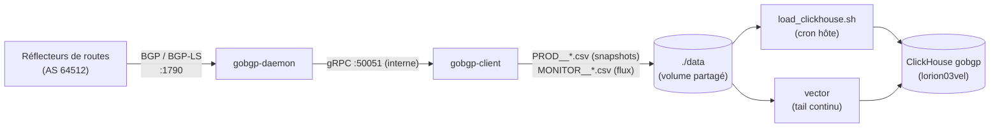

# gobgp — Vue d'ensemble

<span class="status status-active">actif</span> — Collecte BGP-LS conteneurisée (VM `lorion01vel`).

## Présentation

La stack **gobgp** est le point d'entrée des données de **topologie BGP-LS** de la
plateforme. Elle fait tourner un daemon **GoBGP v4.1.0** en conteneur, qui établit des
sessions BGP avec les réflecteurs de route du réseau (AS 64512) et collecte les familles
**Link-State** (`ls`), IPv4 unicast, labelled unicast et L3VPN.

| Composant | Conteneur | Rôle |
|-----------|-----------|------|
| **gobgpd** | `gobgp-daemon` | Daemon GoBGP (sessions BGP, RIB, API gRPC) |
| **gobgp-cli** | `gobgp-client` | Extraction : scripts cron + monitor temps réel → CSV |

| Attribut | Valeur réelle |
|----------|---------------|
| Images | `orion/gobgpd:0.1.0`, `orion/gobgp-cli:0.1.0` (build local) |
| Base des images | `${REGISTRY}/library/ubuntu:22.04` |
| Ports publiés | `1790` → 179 (BGP), `50052` → 50051 (gRPC) |
| Réseau | `lorion01vel-network` (bridge) |
| Volumes | `./data` (CSV produits), `./logs`, `./bin/bgpls` (scripts) |
| VM | `lorion01vel` (dépôt dans `/data/orion-lab-stack`) |

!!! warning "Coexistence avec le gobgpd de production"
    Un gobgpd **systemd v3.37 de production** tourne déjà sur l'hôte et tient les ports
    **179** et **50051**. Le conteneur est donc publié sur **1790/50052** et ne doit
    **jamais** binder directement l'IP de l'hôte (`203.0.113.1`). C'est un mode
    **test/lab** qui coexiste avec la prod sans la toucher.

## Rôle dans l'architecture



Les CSV produits alimentent la base **`gobgp`** de ClickHouse par deux chemins
complémentaires (voir [Collecte des données](collecte.md)), puis `gobgp-neo4j-sync`
projette cette topologie dans le graphe Neo4j.

## Pourquoi cette approche

!!! question "Justification"
    - **Binaires de prod embarqués** : les binaires `gobgpd`/`gobgp` et les scripts de
      collecte sont ceux de la VM de production — le lab reproduit fidèlement la chaîne
      prod, dans un conteneur jetable.
    - **Ports décalés** plutôt que `network_mode: host` : coexistence sûre avec le daemon
      systemd de prod, testée sans interruption de service.
    - **CSV comme interface** : les scripts existants produisent du CSV ; la stack les
      réutilise tels quels au lieu de réécrire la collecte.

## Dépendances & interactions

| Type | Détail |
|------|--------|
| **Dépendances** | Réflecteurs BGP joignables (sessions vers AS 64512), réseau `lorion01vel-network` |
| **Services consommateurs** | `vector` (lecture `./data` en continu), `load_clickhouse.sh` (cron hôte, h+7) |
| **Flux entrants** | BGP `:1790` (sessions établies vers/depuis les réflecteurs) |
| **Flux sortants** | gRPC interne (cli → daemon), aucun accès Internet |

## Structure du code

```text
lorion01vel/gobgp/
├── compose.yml            # 2 services : gobgpd + gobgp-cli
├── daemon/                # Dockerfile + entrypoint (gobgpd -f gobgpd_all.conf)
│   └── gobgpd_all.conf    # config BGP-LS (peers, familles, router-id)
├── client/                # Dockerfile + entrypoint (monitor + cron) + crontab
├── bin/                   # binaires gobgpd / gobgp (copiés de la prod)
│   └── bgpls/             # scripts de collecte (montés dans gobgp-cli)
├── data/                  # CSV produits (volume, hors git)
├── logs/                  # logs daemon + cron (volume, hors git)
├── schemas/               # DDL ClickHouse (00_setup.sql, 01_reader_role.sql)
├── scripts/load_clickhouse.sh   # chargement PROD__*.csv → ClickHouse (cron hôte)
└── gobgp.sh               # helper CLI (neighbors, rib, pull-*, logs, ...)
```

## Pages détaillées

[Architecture](architecture.md) · [Collecte des données](collecte.md) ·
[Déploiement](deployment.md) · [Dépannage](troubleshooting.md)
