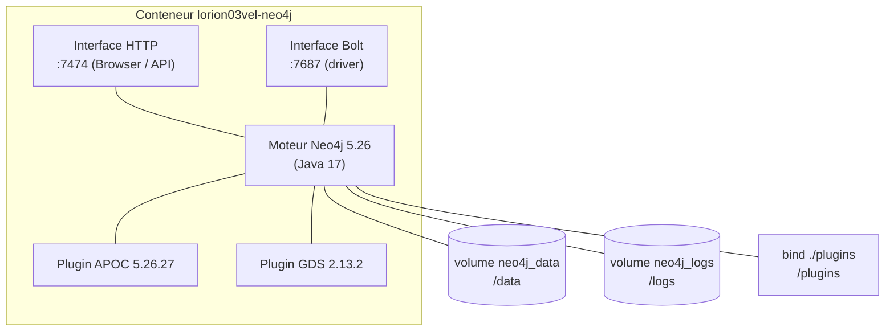
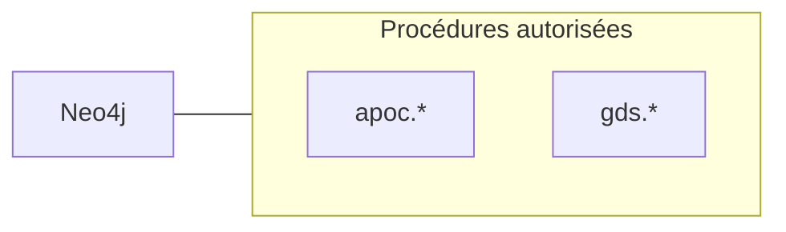

# Neo4j — Architecture

## Composants internes

## Ports

| Port | Interface | Usage |
|------|-----------|-------|
| 7474 | HTTP | Neo4j Browser, API HTTP |
| 7687 | Bolt | Connexions driver (Python `neo4j`, cypher-shell) |
| 7473 | HTTPS | Exposé par l'image mais non utilisé (pas de TLS configuré) |

## Réseau Docker

- Attaché au réseau **`lorion03vel-network`** (bridge, `external: true`).
- Nom résoluble depuis les conteneurs du réseau : `lorion03vel-neo4j`.
- URI de connexion interne : `bolt://lorion03vel-neo4j:7687`.

## Volumes

| Volume / bind | Point de montage | Contenu |
|---------------|------------------|---------|
| `neo4j_data` (nommé) | `/data` | **Données du graphe** (persistant) |
| `neo4j_logs` (nommé) | `/logs` | Journaux |
| `neo4j_import` (nommé) | `/import` | Répertoire d'import (LOAD CSV) |
| `./plugins` (bind) | `/plugins` | **JARs APOC + GDS** (fournis depuis le dépôt) |

!!! info "Pourquoi un bind-mount pour les plugins"
    Le conteneur n'ayant pas d'accès Internet, les plugins ne peuvent pas être téléchargés
    au démarrage. Ils sont versionnés/déposés dans `neo4j/plugins/` et montés en lecture dans
    `/plugins`, où Neo4j les charge au boot.

## Protocoles & communications

| Sens | Protocole | Détail |
|------|-----------|--------|
| Entrant | Bolt (TCP 7687) | Écritures/lectures Cypher du sync et du CLI |
| Entrant | HTTP (TCP 7474) | Neo4j Browser, requêtes API |
| Sortant | *(aucun)* | Neo4j n'appelle aucun service externe |

## Extensions chargées

Les espaces de noms `apoc.*` et `gds.*` sont déclarés dans
`dbms.security.procedures.unrestricted` **et** `dbms.security.procedures.allowlist` (voir
[Configuration](configuration.md)), ce qui autorise le chargement et l'appel de ces procédures.
