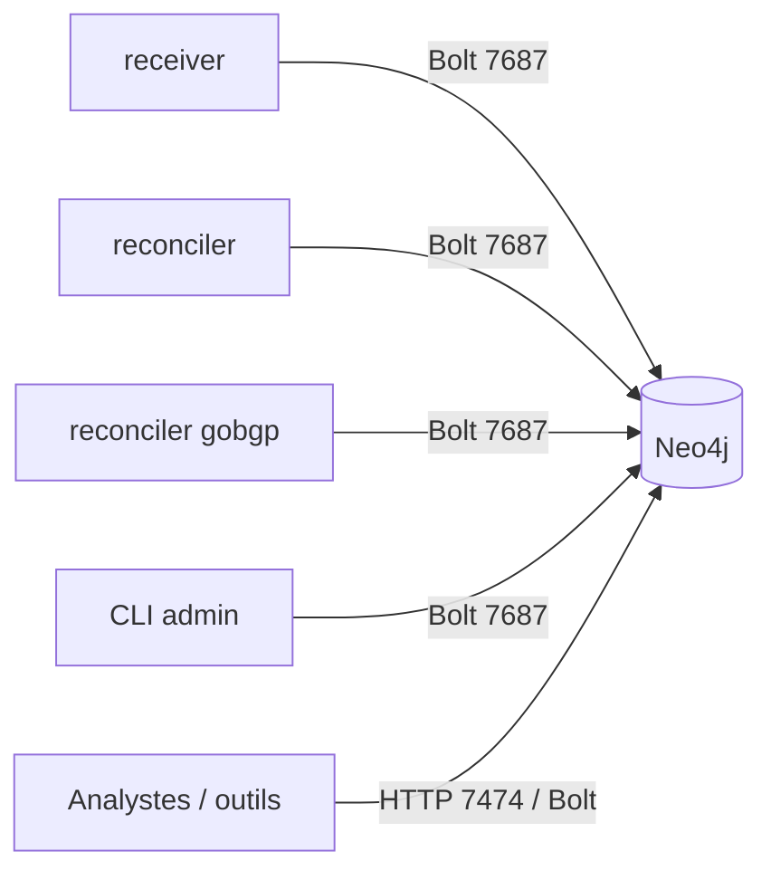

# Neo4j — Vue d'ensemble

actif — Base de données orientée graphe, cœur du modèle de topologie.

## Présentation

**Neo4j 5.26.0** (édition Community) est la base de données de graphe de la plateforme. Elle
stocke les équipements réseau (devices), leurs interconnexions physiques (câblage NetBox,
via [netbox-neo4j-sync](../netbox-neo4j-sync/index.md)) et leur topologie de routage
(adjacences IGP et préfixes BGP-LS, via
[gobgp-neo4j-sync](../gobgp-neo4j-sync/index.md)).
Elle embarque deux extensions installées **hors-ligne** : **APOC** et **Graph Data Science (GDS)**.

| Attribut | Valeur réelle |
|----------|---------------|
| Image | `${REGISTRY}/neo4j:5.26.0` (miroir interne) |
| Conteneur | `lorion03vel-neo4j` |
| Édition | Community (Java 17) |
| Plugins | `apoc-5.26.27-core.jar`, `neo4j-graph-data-science-2.13.2.jar` |
| Réseau | `lorion03vel-network` |
| Ports | 7474 (HTTP), 7687 (Bolt) |

## Rôle dans l'architecture

Neo4j est le **magasin de graphe cible**. Il ne produit pas de données : il est **consommateur**
des écritures du sync et **fournisseur** de requêtes pour les usages analytiques de graphe.

## Pourquoi Neo4j

!!! question "Justification du choix"
    La donnée à modéliser est **intrinsèquement un graphe** (devices reliés par des câbles,
    voisinage, chemins). Une base de graphe permet des requêtes de **parcours** (voisins,
    chemins device→device) naturelles, là où un modèle relationnel imposerait des jointures
    récursives coûteuses. Le plugin **GDS** ouvre en plus les algorithmes de graphe
    (centralité, composantes, plus courts chemins).

## Alternatives étudiées

| Alternative | Pourquoi écartée (dans ce contexte) |
|-------------|-------------------------------------|
| Base relationnelle (PostgreSQL) | Parcours de graphe = jointures récursives lourdes ; pas d'algorithmes de graphe natifs |
| Modélisation graphe dans ClickHouse | ClickHouse est OLAP (analytique colonne), non adapté au parcours de graphe |
| Autre base graphe (JanusGraph, ArangoDB) | Écosystème/outillage (Browser, Cypher, GDS) et simplicité de déploiement Docker en faveur de Neo4j |

## Avantages / Inconvénients

!!! success "Avantages"
    - Langage **Cypher** expressif pour les parcours.
    - **APOC** (utilitaires) et **GDS** (algorithmes) disponibles.
    - Neo4j Browser intégré (port 7474).
    - Déploiement Docker simple, healthcheck fiable.

!!! warning "Inconvénients / limites"
    - Édition **Community** : un seul utilisateur `neo4j`, pas de RBAC ni de clustering.
    - Version de **Java figée (17)** → contraint les versions de GDS (voir Déploiement).
    - Plugins à installer **manuellement** (pas d'accès Internet conteneur).

## Cas d'utilisation

- Retrouver tous les liens physiques d'un device.
- Parcourir un chemin de câblage device → device.
- Appliquer des algorithmes GDS (composantes connexes, centralité) sur la topologie.

## Dépendances & interactions

| Type | Détail |
|------|--------|
| **Dépendances** | Aucune (base autonome) ; nécessite le réseau `lorion03vel-network` et le secret `neo4j_auth` |
| **Services consommateurs** | `receiver`, `reconciler`, `CLI admin`, outils d'analyse |
| **Services producteurs** | *(aucun)* — Neo4j reçoit les écritures, il n'écrit pas ailleurs |
| **Flux entrants** | Bolt 7687 (écritures/lectures Cypher) |
| **Flux sortants** | *(aucun)* |

## Pages détaillées

[Architecture](architecture.md) · [Configuration](configuration.md) · [Sécurité](security.md) ·
[Déploiement](deployment.md) · [Maintenance](maintenance.md) · [Monitoring](monitoring.md) ·
[Dépannage](troubleshooting.md)
