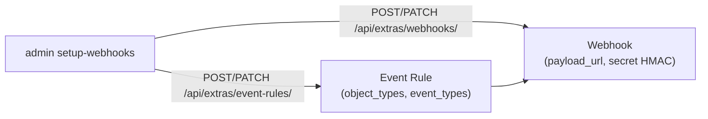

# CLI d'administration

Le CLI (`admin/__main__.py`) automatise la configuration NetBox et la gestion Neo4j. Il
s'exécute via le service reconciler (mêmes `.env` et réseaux) :

```bash
docker compose run --rm reconciler python -m admin <commande>
```

## Commandes

| Commande | Rôle |
|----------|------|
| `stats` | Compteurs du graphe (nœuds, `EST_CONNECTE_A`, labels/rôles) |
| `init` | Synchronisation complète immédiate (bootstrap) |
| `wipe [--drop-constraints] [--yes]` | Purge le graphe (et contraintes si demandé) |
| `delete-device --id N` | Supprime le nœud device d'`Id` N |
| `setup-webhooks [--url U] [--name NAME]` | Crée/MAJ le Webhook + Event Rule NetBox (idempotent) |
| `teardown-webhooks [--name NAME]` | Supprime le Webhook + Event Rule |

## Exemples

=== "Statistiques"

    ```bash
    docker compose run --rm reconciler python -m admin stats
    # Nœuds : 109 | EST_CONNECTE_A : 297 | Rôles/labels (34) : co, collecte, ...
    ```

=== "Bootstrap / re-sync"

    ```bash
    docker compose run --rm reconciler python -m admin init
    ```

=== "Purge puis reconstruction"

    ```bash
    docker compose run --rm reconciler python -m admin wipe --yes
    docker compose run --rm reconciler python -m admin init
    ```

=== "Configurer les webhooks NetBox"

    ```bash
    docker compose run --rm reconciler python -m admin setup-webhooks
    # Crée/MAJ le Webhook -> http://netbox-neo4j-sync-receiver:8000/webhook
    # + une Event Rule sur les objets DCIM/IPAM (create/update/delete)
    ```

## `setup-webhooks` — ce qui est créé dans NetBox

La commande est **idempotente** (crée ou met à jour par nom, défaut `neo4j-sync`) :



| Élément | Valeur posée |
|---------|--------------|
| Webhook `payload_url` | `http://netbox-neo4j-sync-receiver:8000/webhook` |
| Webhook `secret` | `WEBHOOK_SECRET` (du `.env`) |
| Event Rule `object_types` | `dcim.device`, `dcim.interface`, `dcim.consoleport`, `ipam.ipaddress`, `dcim.cable`, `dcim.devicerole` |
| Event Rule `event_types` | `object_created`, `object_updated`, `object_deleted` |

!!! tip "Rotation du secret"
    Changer `WEBHOOK_SECRET` dans `.env`, redémarrer le receiver, puis relancer
    `setup-webhooks` pour propager la même valeur côté NetBox (les deux côtés doivent être
    alignés, sinon 401).

## Où s'exécute le CLI

- **En conteneur** (recommandé) : `docker compose run --rm reconciler python -m admin …` —
  utilise les noms internes (`netbox:8080`, `lorion03vel-neo4j:7687`).
- **Sur l'hôte** : nécessiterait de surcharger `NETBOX_API_URL=http://localhost:9999` et
  `NEO4J_URI=bolt://localhost:7687` (cf. [Réseau](../../architecture/networking.md)).
