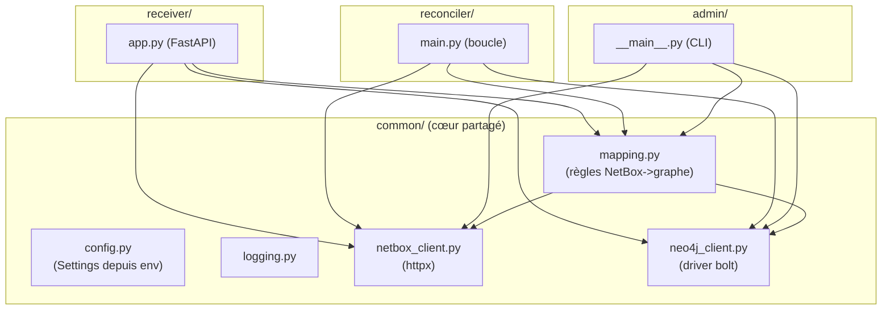
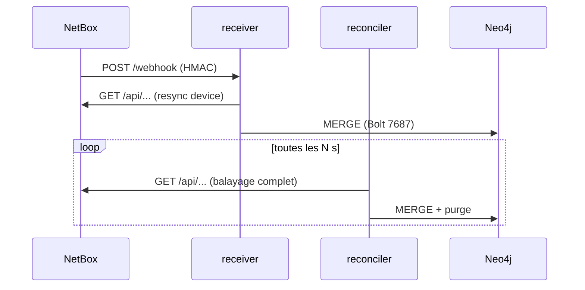

# netbox-neo4j-sync — Architecture

## Composants & modules

!!! abstract "Principe : une source de vérité pour le mapping"
    `common/mapping.py` centralise la traduction NetBox → graphe (nœuds & relations). Il est
    **réutilisé à l'identique** par le receiver (1 objet), le reconciler (balayage complet) et le
    CLI. Un seul endroit à maintenir.

## Conteneurs & ports

| Conteneur | Rôle | Port | Réseaux |
|-----------|------|------|---------|
| `netbox-neo4j-sync-receiver` | FastAPI (webhooks) | 8000 (non publié) | `lorion03vel-network` |
| `netbox-neo4j-sync-reconciler` | Boucle de sync | — | `lorion03vel-network` |

Les deux images sont **construites localement** à partir de
`registry.example.com/dockerhub/library/python:3.12-slim` (voir [Déploiement](deployment.md)).

## Communications

| Flux | Protocole | Détail |
|------|-----------|--------|
| NetBox → receiver | HTTP `:8000` | Webhooks signés HMAC-SHA512 |
| receiver/reconciler → NetBox | HTTP `:8080` | Lecture API REST (token) |
| receiver/reconciler → Neo4j | Bolt `:7687` | Écritures Cypher (`MERGE`) |

## Dépendances Python (`requirements.txt`)

| Paquet | Usage |
|--------|-------|
| `fastapi`, `uvicorn[standard]` | Receiver HTTP |
| `httpx` | Client API NetBox |
| `neo4j` | Driver Bolt |
| `tenacity` | Retries sur erreurs transitoires |
| `python-dotenv` | Chargement `.env` en développement |

## Résilience

- **Retries** (`tenacity`) sur les erreurs réseau transitoires (NetBox HTTP, Neo4j Bolt).
- **Arrêt gracieux** du reconciler (SIGTERM/SIGINT → fin du cycle en cours).
- Le reconciler **capture** les exceptions d'un cycle et **retente** au cycle suivant (ne meurt
  pas sur une erreur ponctuelle).
