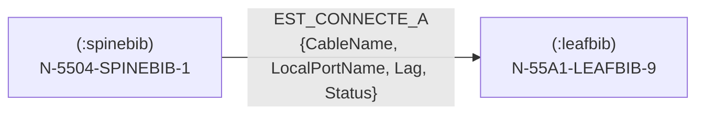

# Modèle de données (graphe)

Le modèle Neo4j est **dénormalisé** : **un nœud par device**, étiqueté par son **rôle**, relié
aux autres devices par des relations `EST_CONNECTE_A`, et rattaché à son site par une relation
`EST_HEBERGE_DANS` vers un nœud `:SITE`. La logique de mapping vit dans `common/mapping.py`.

## Nœud device

- **Label** = rôle **feuille** du device (ex. `:spinebib`, `:pesms`). L'ensemble des labels du
  graphe = l'ensemble des rôles NetBox.
- **Clé** = `Id` (= `device.id`), avec contrainte d'unicité par label.

```cypher
(:spinebib {
  Id, Nom, Role, Fonction, Manufacturer, Chassis, Site, Rack,
  Position, Face, Entite, LastUpdate,
  ConsolePorts: [...], Loopback123: "10.104.133.3/32"
})
```

| Propriété | Source NetBox |
|-----------|---------------|
| `Id` | `device.id` (clé `MERGE`) |
| `Nom` | `device.name` |
| `Role` | `device.role.name` (rôle **feuille**) |
| `Fonction` | rôle **racine** (remontée des parents jusqu'à profondeur 0) |
| `Manufacturer` | `device.device_type.manufacturer.name` |
| `Chassis` | `device.device_type.model` |
| `Site` | `device.site.id` |
| `Rack` | `device.rack.name` |
| `Position` | `device.position` |
| `Face` | `device.face.label` |
| `Entite` | `device.tenant.name` |
| `LastUpdate` | `device.last_updated` |
| `ConsolePorts` | liste `"nom (label_câble)"` depuis `dcim/console-ports` |
| `Loopback*` | IP (IPAM) des interfaces nommées `Loopback*` |

!!! info "Rôles hiérarchiques : Role vs Fonction"
    Les device-roles NetBox sont **hiérarchiques**. Exemple réel : `spinebib` a pour parent
    `coreip`. Le mapping en déduit `Role = spinebib` (feuille) et `Fonction = coreip` (racine).

## Relation `EST_CONNECTE_A`

Une relation **par câble** entre deux devices (orientée `a_termination → b_termination`) :

```cypher
(a)-[:EST_CONNECTE_A {
  CableName, Source, Destination, LocalPortName, RemoteDevicePort,
  InterfaceId, RemoteDeviceId, Lag, Status
}]->(b)
```

| Propriété | Source |
|-----------|--------|
| `CableName` | `cable.label` |
| `Source` / `Destination` | noms des devices côté a / b |
| `LocalPortName` / `RemoteDevicePort` | noms des interfaces côté a / b |
| `InterfaceId` | id de l'interface côté a |
| `RemoteDeviceId` | id du device côté b |
| `Lag` | `interface.lag.name` (côté a) |
| `Status` | `Enabled`/`Disabled` selon `interface.enabled` (côté a) |



## Nœud `:SITE` et relation `EST_HEBERGE_DANS`

Un nœud **`:SITE`** unique représente le site physique hébergeant les équipements
(`Nom` = référentiel interne, ex. `782061` — configurable via `SITE_NOM`, ce n'est
**pas** un objet NetBox) :

```cypher
(:SITE {Nom: "782061", Role: "SITE"})
(device)-[:EST_HEBERGE_DANS]->(:SITE)
```

- Contrainte d'unicité sur `SITE.Nom` (`site_nom`).
- Le reconciler rattache **tous** les devices au site à la fin de chaque cycle ; le
  receiver rattache chaque device dès sa création (le `MERGE` du site permet à un
  webhook de précéder le premier cycle).
- Les nœuds `:SITE` sont exclus du rattachement (pas d'auto-relation).

## Contraintes & idempotence

- `ensure_constraints(role_labels)` crée une contrainte d'unicité `Id` **par label de rôle**.
- Toutes les écritures sont des `MERGE` → **idempotentes** (receiver + reconciler compatibles).
- Les labels de rôle sont **validés** (back-quotés, rejet de tout backtick) pour éviter
  l'injection Cypher.

## Requêtes d'exemple

```cypher
// Un device et ses propriétés
MATCH (d {Id:122})
RETURN labels(d), d.Nom, d.Role, d.Fonction, d.Loopback123;

// Câblage device <-> device
MATCH (a {Id:122})-[r:EST_CONNECTE_A]-(b)
RETURN r.CableName, r.Source, r.Destination, r.Lag LIMIT 5;

// Répartition par rôle
MATCH (n) RETURN labels(n)[0] AS role, count(*) ORDER BY role;
```

!!! note "Hors périmètre du modèle"
    Le champ `New` (montré dans certains exemples) **n'a pas de source** dans le NetBox actuel :
    il est volontairement **omis** (pas d'invention).
