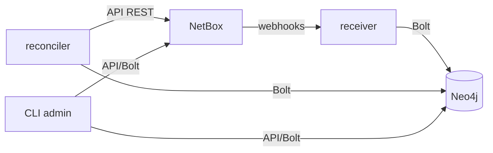

# netbox-neo4j-sync — Vue d'ensemble

<span class="status status-active">actif</span> — Application de synchronisation NetBox → Neo4j.

## Présentation

`netbox-neo4j-sync` est une application **Python** développée sur mesure qui projette les
données DCIM de NetBox dans Neo4j. Elle combine deux mécanismes complémentaires et un outil
d'administration :

| Composant | Rôle | Technologie |
|-----------|------|-------------|
| **receiver** | Reçoit les webhooks NetBox et applique en **temps réel** | FastAPI + Uvicorn |
| **reconciler** | Synchronisation **complète périodique** + purge | Python (boucle) |
| **CLI admin** | Administration (init, wipe, stats, webhooks) | Python (`argparse`) |

## Rôle dans l'architecture

C'est le **trait d'union** entre NetBox (source) et Neo4j (graphe). Il consomme l'API NetBox et
les webhooks, et écrit dans Neo4j.



## Pourquoi cette approche

!!! question "Justification"
    - **Webhooks directs (sans bus de messages)** : latence faible, pas d'infrastructure
      supplémentaire (Kafka/RabbitMQ) à opérer — adapté au périmètre actuel.
    - **Reconciler périodique** en complément : garantit la **convergence** (rattrape les
      webhooks manqués, les suppressions hors-ligne), NetBox restant la source de vérité.
    - **Idempotence** (`MERGE` partout) : receiver et reconciler peuvent tourner en parallèle.

## Alternatives étudiées

| Alternative | Décision |
|-------------|----------|
| Bus d'événements (Kafka/RabbitMQ) | Écarté pour l'instant (surcoût opérationnel) — cf. [Roadmap](../../architecture/roadmap.md) |
| Reconciler seul (polling) | Insuffisant pour le temps réel |
| Webhook → écriture directe **sans** reconciler | Pas de rattrapage des événements manqués |

## Dépendances & interactions

| Type | Détail |
|------|--------|
| **Dépendances** | NetBox (API + webhooks), Neo4j (Bolt) ; réseau partagé `lorion03vel-network` |
| **Services consommateurs** | *(aucun)* — c'est un producteur d'écritures Neo4j |
| **Services producteurs (sources)** | NetBox (webhooks + API) |
| **Flux entrants** | Webhooks HTTP (NetBox → receiver `:8000`) |
| **Flux sortants** | API REST NetBox (`:8080`), Bolt Neo4j (`:7687`) |

## Structure du code

```text
netbox-neo4j-sync/
├── common/          # config, logging, clients Neo4j & NetBox, mapping (cœur métier)
├── receiver/        # app.py (FastAPI)
├── reconciler/      # main.py (boucle)
├── admin/           # __main__.py (CLI)
├── Dockerfile.receiver / Dockerfile.reconciler
├── compose.yml
└── .env / .env.example / requirements.txt
```

## Pages détaillées

[Architecture](architecture.md) · [Receiver](receiver.md) · [Reconciler](reconciler.md) ·
[CLI admin](admin-cli.md) · [Modèle de données](data-model.md) · [Configuration](configuration.md) ·
[Sécurité](security.md) · [Déploiement](deployment.md) · [Dépannage](troubleshooting.md)
