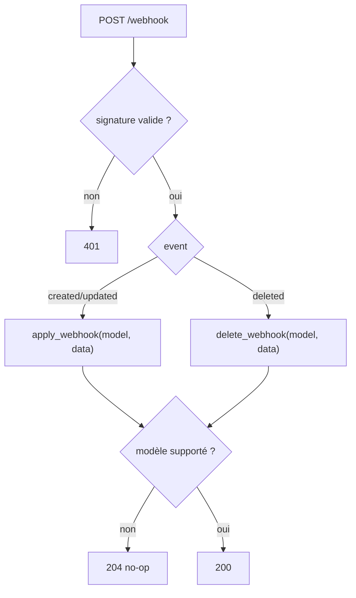

# Receiver (FastAPI)

Le **receiver** (`receiver/app.py`) est un service FastAPI qui reçoit les webhooks NetBox et
applique les changements en **quasi temps réel** dans Neo4j.

## Endpoints

| Méthode | Chemin | Rôle |
|---------|--------|------|
| `POST` | `/webhook` | Réception des événements NetBox (signés HMAC) |
| `GET` | `/healthz` | Sonde : 200 si Neo4j joignable, sinon 503 |

## Vérification de signature (HMAC-SHA512)

NetBox signe le corps du webhook avec `WEBHOOK_SECRET` et transmet le digest dans l'en-tête
`X-Hook-Signature`. Le receiver recalcule et compare en temps constant :

```python
expected = hmac.new(settings.webhook_secret.encode(), raw_body, hashlib.sha512).hexdigest()
if not hmac.compare_digest(expected, signature):
    raise HTTPException(status_code=401, detail="Signature invalide")
```

!!! danger "Secret vide = vérification désactivée"
    Si `WEBHOOK_SECRET` est vide, le receiver **journalise un avertissement et accepte tout**.
    Toujours définir un secret fort (voir [Sécurité](security.md)).

## Format du payload NetBox 4.x

!!! warning "`object_type`, pas `model`"
    NetBox 4.5 envoie le champ **`object_type`** (ex. `dcim.device`) et non `model`. Le receiver
    en extrait le nom du modèle (partie après le point) :
    ```python
    object_type = payload.get("object_type") or ""
    model = payload.get("model") or (object_type.rsplit(".", 1)[-1] if object_type else None)
    ```
    Le champ `event` vaut `created` / `updated` / `deleted`.

## Dispatch des événements



Modèles traités et action :

| `object_type` | Action `apply` (created/updated) | Action `delete` |
|---------------|----------------------------------|-----------------|
| `dcim.device` | resync du device | suppression du nœud |
| `dcim.interface` | resync du device parent | resync du device parent |
| `dcim.consoleport` | resync du device parent | resync du device parent |
| `ipam.ipaddress` | resync du device (via interface) | resync du device |
| `dcim.cable` | recrée la relation | suppression de la relation |
| `dcim.devicerole` | rafraîchit la hiérarchie des rôles | — |
| *(autre)* | no-op (204) | no-op (204) |

!!! info "Resync = ré-interrogation NetBox"
    Le modèle étant **dénormalisé**, un webhook ne contient pas toutes les données jointes. Le
    receiver **ré-interroge l'API NetBox** pour reconstruire le nœud device complet (interfaces,
    IP loopback, console-ports, rôle racine). Voir [Modèle de données](data-model.md).

## Exécution

Lancé par Uvicorn (un seul worker — le client Neo4j est partagé en mémoire du process) :

```dockerfile
CMD ["uvicorn", "receiver.app:app", "--host", "0.0.0.0", "--port", "8000", "--workers", "1"]
```

!!! tip "Mise à l'échelle"
    Pour augmenter le débit, **répliquer le conteneur** plutôt qu'augmenter `--workers`.

## Cycle de vie

Au démarrage (`lifespan`), le receiver instancie le client Neo4j, le client NetBox et charge la
hiérarchie des rôles ; à l'arrêt, il ferme proprement les connexions.
