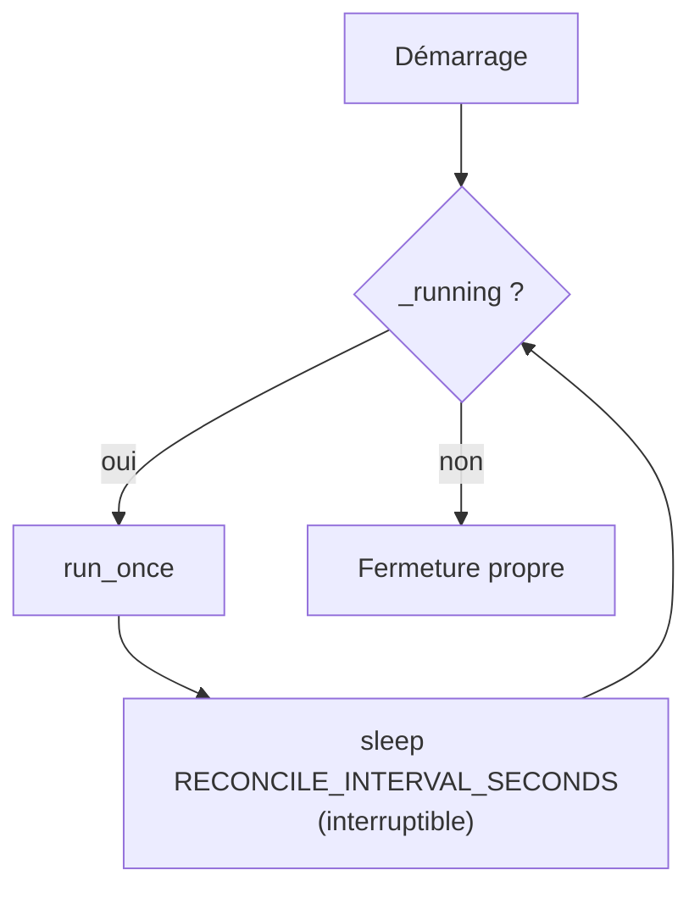
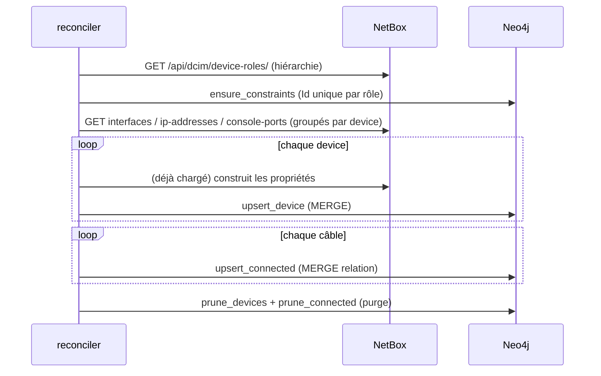

# Reconciler

Le **reconciler** (`reconciler/main.py`) exécute une **synchronisation complète périodique** de
NetBox vers Neo4j et **purge** les objets disparus. Il garantit la convergence même si des
webhooks ont été manqués.

## Boucle principale



- Intervalle : `RECONCILE_INTERVAL_SECONDS` (défaut **900 s**).
- **Arrêt gracieux** : SIGTERM/SIGINT → fin du cycle courant puis sortie.
- Un échec de cycle est **journalisé** et retenté au cycle suivant (la boucle ne meurt pas).

## Déroulé d'un cycle (`run_once`)



Étapes réelles :

1. **Hiérarchie des rôles** (`build_role_hierarchy`) pour calculer `Role` (feuille) et
   `Fonction` (racine).
2. **Contraintes** d'unicité `Id` par label de rôle (`ensure_constraints`).
3. **Récupération groupée** des interfaces, IP et console-ports (indexées par device) pour
   éviter N appels.
4. **Upsert des nœuds device** (`MERGE`), collecte des `Id` vus.
5. **Upsert des relations** `EST_CONNECTE_A` (une par câble).
6. **Purge** : suppression des devices et relations absents de NetBox.
7. **Rattachement au site** : `MERGE` du nœud `:SITE` (`SITE_NOM`) puis relation
   `EST_HEBERGE_DANS` pour tous les devices.

## Objets interrogés

| Endpoint NetBox | Usage |
|-----------------|-------|
| `/api/dcim/device-roles/` | Hiérarchie (Fonction) |
| `/api/dcim/devices/` | Nœuds |
| `/api/dcim/interfaces/` | LAG, état, ports (relations) |
| `/api/ipam/ip-addresses/` | Propriétés `Loopback*` |
| `/api/dcim/console-ports/` | Propriété `ConsolePorts` |
| `/api/dcim/cables/` | Relations `EST_CONNECTE_A` |

!!! warning "Ne pas envoyer le paramètre `brief`"
    NetBox active le mode abrégé dès que le paramètre `brief` est **présent** (même `brief=false`).
    Le client ne l'envoie donc pas, sinon les objets liés imbriqués (site, rôle, terminaisons de
    câble…) seraient absents et les relations non créées. C'est un bug réel corrigé.

## Purge

- `prune_devices(seen_ids, roles)` : supprime les nœuds dont l'`Id` n'a pas été vu (par label de
  rôle).
- `prune_connected(seen_cables)` : supprime les relations `EST_CONNECTE_A` dont le `CableName` n'a
  pas été vu.

## Journalisation

Chaque cycle se termine par un résumé :

```
Cycle terminé : 109 device(s), 283 relation(s) EST_CONNECTE_A, 109 device(s) rattaché(s) au site 782061 (EST_HEBERGE_DANS).
```
