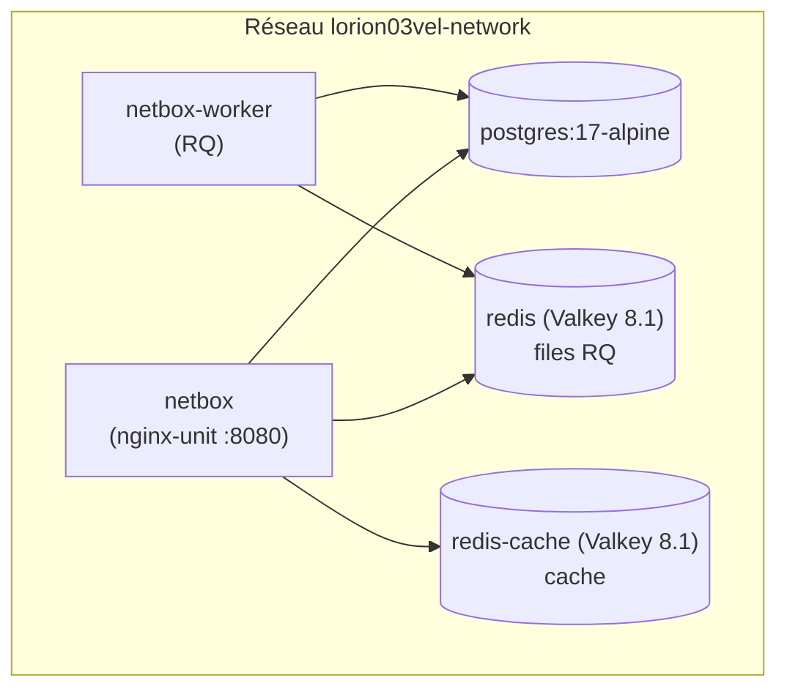
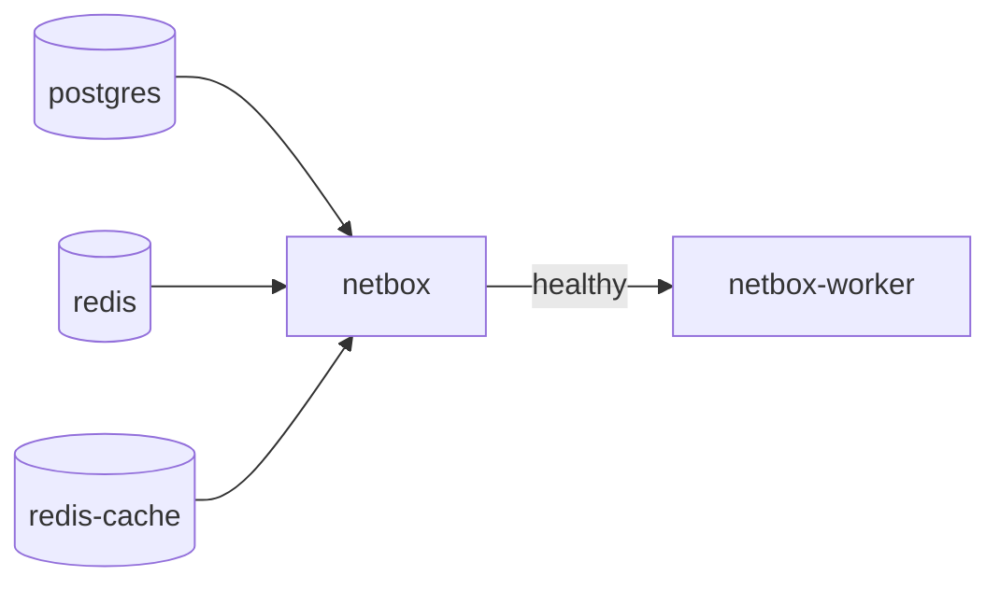

# NetBox — Architecture

## Composants (netbox-docker)

| Service | Image | Rôle |
|---------|-------|------|
| `netbox` | `netbox:v4.5.4-4.0.1-plugins` | Application web + API (unit sur 8080) |
| `netbox-worker` | idem | Worker RQ (webhooks, jobs asynchrones) |
| `postgres` | `postgres:17-alpine` | Base de données principale |
| `redis` | `valkey/valkey:8.1-alpine` | Files de tâches RQ (persistant, `--appendonly yes`) |
| `redis-cache` | `valkey/valkey:8.1-alpine` | Cache applicatif (non persistant) |

!!! note "Image `-plugins` construite localement"
    Le `docker-compose.override.yml` construit une image locale `netbox:…-plugins` (via
    `Dockerfile-Plugins`) avec `pull_policy: never`, en passant le proxy en build-arg
    (`HTTP_PROXY`/`HTTPS_PROXY`/`NO_PROXY`). NetBox intègre donc des plugins additionnels.

## Ports

| Service | Port interne | Publié sur l'hôte |
|---------|-------------|-------------------|
| netbox | 8080 (unit) | **9999** |
| postgres | 5432 | *(interne)* |
| redis / redis-cache | 6379 | *(interne)* |

## Volumes

| Volume | Contenu |
|--------|---------|
| `netbox-postgres-data` | Données PostgreSQL |
| `netbox-redis-data` | Données Redis (files RQ) |
| `netbox-redis-cache-data` | Données Redis-cache |
| `netbox-media-files` | Médias (`/opt/netbox/netbox/media`) |
| `netbox-reports-files` | Rapports |
| `netbox-scripts-files` | Scripts custom |

## Serveur d'application

!!! info "nginx-unit interne (pas un reverse proxy de plateforme)"
    L'image NetBox embarque **nginx-unit** qui sert l'application sur le port 8080. Ce n'est pas
    un reverse proxy mutualisé au niveau de la plateforme — il est interne au conteneur NetBox.

## Dépendances de démarrage

- `netbox` dépend de `postgres`, `redis`, `redis-cache`.
- `netbox-worker` attend que `netbox` soit **healthy** (`condition: service_healthy`).
