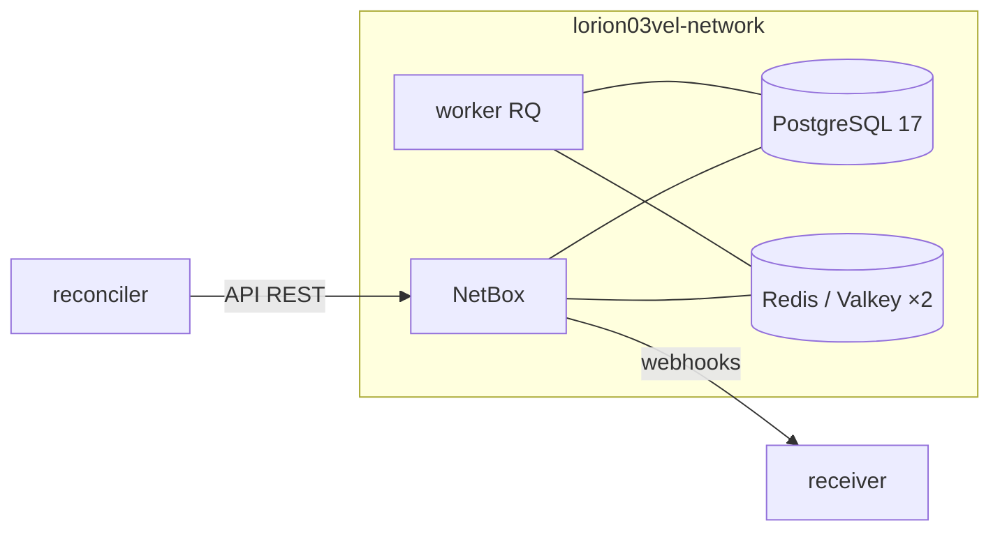

# NetBox — Vue d'ensemble

externe — Source de vérité DCIM, déployée hors de ce dépôt.

## Présentation

**NetBox v4.5.4** est l'outil de **modélisation d'infrastructure (DCIM/IPAM)** qui sert de
**source de vérité** à la plateforme. Il est déployé séparément via **netbox-docker** dans
`/home/services/netbox-docker/` (hors du dépôt `orion-lab-stack`). Cette section le documente en
tant que **dépendance externe** et détaille son **intégration** avec `netbox-neo4j-sync`.

| Attribut | Valeur réelle |
|----------|---------------|
| Image | `netbox:v4.5.4-4.0.1-plugins` (build local depuis `netboxcommunity/netbox:v4.5.4-4.0.1`) |
| Emplacement | `/home/services/netbox-docker/` |
| Réseau | `lorion03vel-network` (réseau partagé de la VM, via l'override) |
| Accès | `http://localhost:9998` (publié) → conteneur `:8080` — 9999 = NetBox de PROD sur le même hôte |
| Composants | `netbox`, `netbox-worker`, `postgres`, `redis`, `redis-cache` |

!!! info "Hors périmètre de ce dépôt"
    NetBox n'est pas géré par le projet `lorion03vel`. Sa configuration complète relève du
    projet `netbox-docker`. On documente ici ce qui est **nécessaire à l'intégration** et les
    faits observables (services, ports, healthchecks).

## Rôle dans l'architecture

NetBox est le **producteur** de données : il émet des **webhooks** (via son worker) et expose
une **API REST** que le sync consomme.

## Pourquoi NetBox

!!! question "Justification"
    NetBox est l'outil **standard** de source de vérité réseau (DCIM/IPAM) : modélisation des
    sites, racks, devices, interfaces, câbles, IP… avec une **API REST** complète et un système
    de **webhooks/Event Rules** — exactement ce qu'il faut pour alimenter un graphe en temps réel.

## Composants (sous-pages)

| Composant | Rôle | Page |
|-----------|------|------|
| NetBox (app) | Interface + API REST | [Architecture](architecture.md) |
| Intégration | Webhooks / Event Rules / API | [Intégration](integration.md) |
| PostgreSQL | Base de données | [PostgreSQL](postgresql.md) |
| Redis / Valkey | Cache + files RQ | [Redis / Valkey](redis.md) |
| Worker | Traitement asynchrone (webhooks, jobs) | [Worker RQ](worker.md) |

## Interactions avec la plateforme

| Type | Détail |
|------|--------|
| **Services consommateurs** | `receiver` (webhooks), `reconciler` (API), `CLI admin` |
| **Dépendances internes** | PostgreSQL, Redis, Redis-cache |
| **Flux entrants** | HTTP `:8080` (API, UI) |
| **Flux sortants** | Webhooks HTTP vers le receiver |

## Pages détaillées

[Architecture](architecture.md) · [Intégration](integration.md) · [PostgreSQL](postgresql.md) ·
[Redis / Valkey](redis.md) · [Worker RQ](worker.md) · [Configuration](configuration.md) ·
[Sécurité](security.md) · [Dépannage](troubleshooting.md)
