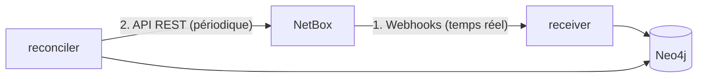
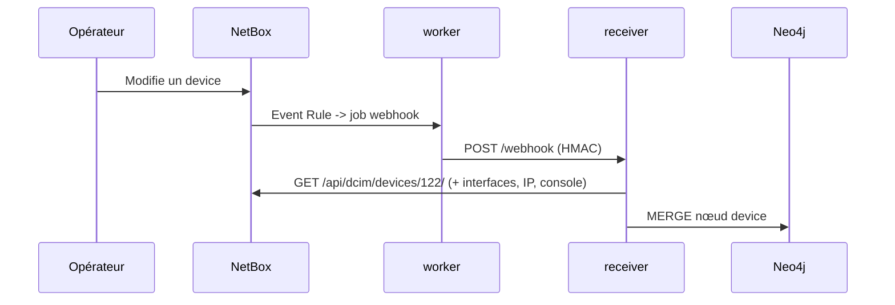

# NetBox — Intégration avec la plateforme

Cette page décrit **comment** NetBox alimente Neo4j via `netbox-neo4j-sync`.

## Deux canaux



1. **Webhooks** — NetBox déclenche un POST HTTP vers le receiver à chaque changement.
2. **API REST** — le reconciler balaie périodiquement les objets pour garantir la convergence.

## Webhooks & Event Rules (NetBox 4.x)

NetBox 4.x déclenche les webhooks via des **Event Rules**. La configuration est automatisée par
le CLI :

```bash
docker compose run --rm reconciler python -m admin setup-webhooks
```

| Objet NetBox posé | Valeur |
|-------------------|--------|
| **Webhook** `payload_url` | `http://netbox-neo4j-sync-receiver:8000/webhook` |
| **Webhook** `secret` | `WEBHOOK_SECRET` (HMAC-SHA512) |
| **Event Rule** `object_types` | `dcim.device`, `dcim.interface`, `dcim.consoleport`, `ipam.ipaddress`, `dcim.cable`, `dcim.devicerole` |
| **Event Rule** `event_types` | `object_created`, `object_updated`, `object_deleted` |

### Corps de webhook (format réel 4.5)

```json
{
  "event": "updated",
  "object_type": "dcim.device",
  "data": { "id": 122, "name": "...", "...": "..." },
  "snapshots": { "...": "..." }
}
```

!!! warning "`object_type` et non `model`"
    NetBox 4.5 envoie **`object_type`** (`dcim.device`). Le corps est **signé HMAC-SHA512**
    (en-tête `X-Hook-Signature`), calculé avec le `secret` du Webhook.

### Traitement asynchrone

Les webhooks sont **enfilés puis émis par le `netbox-worker` (RQ)**, pas par le processus web.
Un webhook peut donc arriver avec un léger délai. En cas d'échec côté receiver, le worker
journalise l'erreur (ex. `Status 400 returned … webhook FAILED to process`).

## API REST consommée

Le reconciler et le receiver lisent l'API (token `Authorization: Token …`) :

| Endpoint | Usage |
|----------|-------|
| `/api/status/` | Vérification de connectivité/version |
| `/api/dcim/device-roles/` | Hiérarchie des rôles |
| `/api/dcim/devices/` | Devices |
| `/api/dcim/interfaces/` | Interfaces (LAG, état) |
| `/api/ipam/ip-addresses/` | IP (loopbacks) |
| `/api/dcim/console-ports/` | Console-ports |
| `/api/dcim/cables/` | Câbles (relations) |

## Séquence complète



!!! tip "Vérifier l'intégration de bout en bout"
    ```bash
    # 1. Poser la config
    docker compose run --rm reconciler python -m admin setup-webhooks
    # 2. Modifier un device dans NetBox (UI ou API)
    # 3. Observer le receiver
    docker compose logs receiver | grep "Webhook appliqué"
    ```
