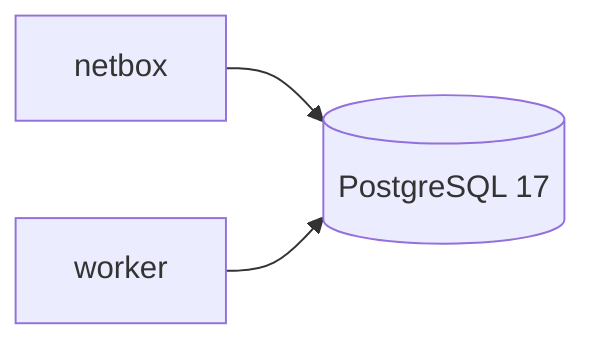

# PostgreSQL (NetBox)

<span class="status status-external">externe</span> — Base de données principale de NetBox.

## Rôle

PostgreSQL stocke **toutes les données NetBox** (devices, interfaces, IP, câbles, utilisateurs,
webhooks, event rules…). C'est la base OLTP de la source de vérité.

| Attribut | Valeur réelle |
|----------|---------------|
| Image | `registry.example.com/dockerhub/postgres:17-alpine` |
| Service | `postgres` (projet `netbox-docker`) |
| Réseau | `lorion03vel-network` |
| Port | 5432 (interne) |
| Volume | `netbox-postgres-data` → `/var/lib/postgresql/data` |
| Config | `env/postgres.env` (netbox-docker) |

## Rôle dans l'architecture



- **Consommateurs** : `netbox`, `netbox-worker`.
- **Producteurs** : *(aucun externe)* — écrit uniquement par NetBox.

## Healthcheck

```yaml
healthcheck:
  test: pg_isready -q -t 2 -d $$POSTGRES_DB -U $$POSTGRES_USER
  interval: 10s
  retries: 5
```

## Variables (`env/postgres.env`)

| Variable | Rôle |
|----------|------|
| `POSTGRES_DB` | Nom de la base |
| `POSTGRES_USER` | Utilisateur |
| `POSTGRES_PASSWORD` | Mot de passe (aligné à `DB_PASSWORD` de NetBox) |

!!! note "Cohérence des identifiants"
    Les variables `DB_*` de `env/netbox.env` (`DB_HOST=postgres`, `DB_NAME`, `DB_USER`,
    `DB_PASSWORD`) doivent correspondre aux `POSTGRES_*` de `env/postgres.env`.

## Sauvegarde / restauration

=== "Dump logique"

    ```bash
    docker exec netbox-docker-postgres-1 \
      pg_dump -U <user> <db> > netbox_$(date +%F).sql
    ```

=== "Restauration"

    ```bash
    cat netbox_<date>.sql | docker exec -i netbox-docker-postgres-1 \
      psql -U <user> -d <db>
    ```

!!! warning "Portée"
    La gestion de PostgreSQL relève du projet **netbox-docker**. Les commandes ci-dessus sont
    fournies pour l'exploitation ; adapter les noms de conteneur/utilisateur à l'installation.

## Commandes utiles

```bash
docker exec -it netbox-docker-postgres-1 psql -U <user> -d <db> -c "\dt"
docker compose -f /home/services/netbox-docker/docker-compose.yml logs -f postgres
```
