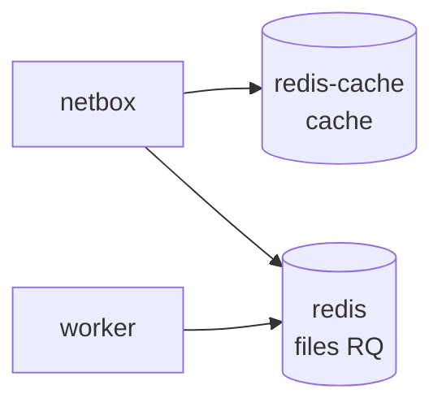

# Redis / Valkey (NetBox)

<span class="status status-external">externe</span> — Cache et files de tâches de NetBox.

NetBox utilise **deux instances** Valkey (fork open-source de Redis), aux rôles distincts.

| Instance | Image | Rôle | Persistance |
|----------|-------|------|-------------|
| `redis` | `valkey/valkey:8.1-alpine` | **Files de tâches RQ** (webhooks, jobs) | Oui (`--appendonly yes`) |
| `redis-cache` | `valkey/valkey:8.1-alpine` | **Cache** applicatif | Non |

## Rôle dans l'architecture



- `redis` porte les **files RQ** : c'est par là que transitent les **webhooks** avant émission
  par le worker.
- `redis-cache` accélère les lectures applicatives (peut être vidé sans perte).

## Configuration (commandes réelles)

=== "redis (persistant)"

    ```yaml
    command:
      - sh
      - -c
      - valkey-server --appendonly yes --requirepass $$REDIS_PASSWORD
    volumes: [ "netbox-redis-data:/data" ]
    ```

=== "redis-cache (éphémère)"

    ```yaml
    command:
      - sh
      - -c
      - valkey-server --requirepass $$REDIS_PASSWORD
    volumes: [ "netbox-redis-cache-data:/data" ]
    ```

## Authentification

Les deux instances exigent un mot de passe (`--requirepass $REDIS_PASSWORD`). Les variables
`REDIS_PASSWORD` (fichiers `env/redis.env`, `env/redis-cache.env`) doivent correspondre aux
`REDIS_HOST/REDIS_PASSWORD` et `REDIS_CACHE_HOST/REDIS_CACHE_PASSWORD` de `env/netbox.env`.

## Healthcheck

```yaml
healthcheck:
  test: '[ $$(valkey-cli --pass "$${REDIS_PASSWORD}" ping) = ''PONG'' ]'
  interval: 1s
  retries: 5
```

## Ports & volumes

| Instance | Port interne | Volume |
|----------|-------------|--------|
| `redis` | 6379 | `netbox-redis-data` |
| `redis-cache` | 6379 | `netbox-redis-cache-data` |

!!! note "Interne à NetBox"
    Ces instances ne sont pas exposées sur l'hôte ni utilisées directement par la plateforme
    Orion : elles servent uniquement NetBox et son worker.
