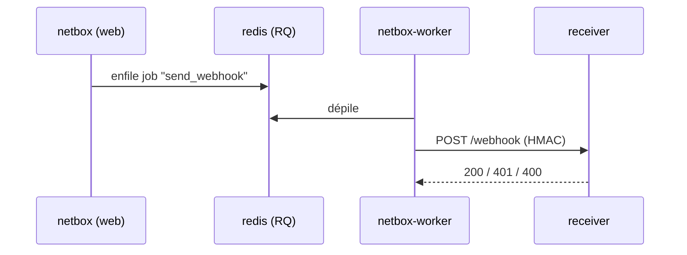

# Worker RQ (NetBox)

<span class="status status-external">externe</span> — Traitement asynchrone des tâches NetBox.

## Rôle

`netbox-worker` exécute les **tâches asynchrones** de NetBox via **RQ** (Redis Queue) : c'est
lui qui **émet réellement les webhooks** (dont ceux vers le receiver), ainsi que d'autres jobs
(rapports, scripts).

| Attribut | Valeur réelle |
|----------|---------------|
| Service | `netbox-worker` (réutilise l'image `netbox`) |
| Commande | `python manage.py rqworker` |
| File | `redis` (Valkey, `--appendonly yes`) |
| Démarrage | après que `netbox` soit **healthy** |

## Place dans le flux webhook



!!! info "Conséquence : asynchronisme"
    Comme le worker traite la file, la livraison d'un webhook peut être **légèrement différée**
    par rapport à la modification dans l'UI. Un worker arrêté = **pas de webhooks émis** (mais
    le reconciler rattrape au cycle suivant).

## Configuration réelle

```yaml
netbox-worker:
  <<: *netbox            # même image/config de base que netbox
  depends_on:
    netbox:
      condition: service_healthy
  command:
    - /opt/netbox/venv/bin/python
    - /opt/netbox/netbox/manage.py
    - rqworker
  healthcheck:
    test: ps -aux | grep -v grep | grep -q rqworker || exit 1
```

!!! note "Proxy désactivé pour le worker"
    Le worker force `HTTP_PROXY`/`HTTPS_PROXY` vides et `NO_PROXY="*"` : ses appels (dont les
    webhooks internes) ne passent **pas** par le proxy d'entreprise, ce qui est nécessaire pour
    joindre le receiver sur le réseau Docker.

## Exploitation

```bash
# Logs du worker (traitement des webhooks)
docker logs -f netbox-docker-netbox-worker-1

# Vérifier qu'un webhook a été traité
docker logs --since 2m netbox-docker-netbox-worker-1 | grep -i webhook
```

!!! tip "Diagnostic d'un webhook non reçu"
    Si le receiver ne voit rien, vérifier **d'abord le worker** : c'est lui qui envoie. Un
    `Status 400/401 returned … webhook FAILED to process` y indique un problème côté receiver
    (format ou signature).
