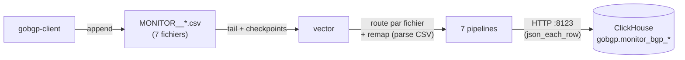

# vector — Vue d'ensemble

actif — Expédition temps réel des événements BGP vers ClickHouse (VM `lorion01vel`).

## Présentation

**Vector 0.46.1** (Datadog) est le pipeline d'ingestion **temps réel** de la plateforme :
il taille (*tail*) les CSV **`MONITOR__*.csv`** produits en continu par `gobgp-client`,
parse chaque ligne et l'insère dans les tables **`gobgp.monitor_bgp_*`** de ClickHouse.

| Attribut | Valeur réelle |
|----------|---------------|
| Image | `${REGISTRY}/timberio/vector:0.46.1-debian` (miroir interne) |
| Conteneur | `lorion01vel-vector` |
| Réseau | `lorion01vel-network` |
| Config | `vector.yaml` (montée en lecture seule) |
| Entrée | `../gobgp/data/MONITOR__*.csv` (montage `:ro`) |
| Sortie | ClickHouse `http://10.10.3.141:8123`, base `gobgp`, user `gobgp_writer` |
| État | volume `vector_data` (`/var/lib/vector`, checkpoints de lecture) |

!!! info "Pourquoi l'IP hôte `10.10.3.141` ici ?"
    vector tourne sur **lorion01vel** : il joint ClickHouse (conteneur sur lorion03vel)
    par le **port publié** de l'autre VM. La règle « jamais l'IP hôte » ne vaut que pour
    les conteneurs de **lorion03vel** (hairpin NAT bloqué localement).

## Rôle dans l'architecture

Complémentaire du chargement horaire par cron (`load_clickhouse.sh`, snapshots
`PROD__*`) : vector porte la **fraîcheur** (chaque UPDATE/WITHDRAW BGP arrive en
quelques secondes), le cron porte l'**état complet**.

## Pourquoi vector

!!! question "Justification du choix"
    - **File source avec checkpoints** : reprise exacte après redémarrage, sans
      ré-ingérer les lignes déjà envoyées (offsets persistés dans `vector_data`).
    - **Sink ClickHouse natif** : insertion `json_each_row` par lot, sans code maison.
    - **VRL (remap)** : parsing/typage des CSV en configuration, défensif (voir
      [Pipeline](pipeline.md)).
    - Léger (un binaire), image disponible sur le miroir.

## Dépendances & interactions

| Type | Détail |
|------|--------|
| **Dépendances** | CSV de `gobgp-client` (montage lecture seule), ClickHouse lorion03vel joignable en `:8123`, secret `ch_gobgp_password` |
| **Services consommateurs** | `gobgp-neo4j-sync` (lit les tables `monitor_bgp_*`) |
| **Flux entrants** | *(aucun — lit un volume local)* |
| **Flux sortants** | HTTP `:8123` vers ClickHouse (auth basic `gobgp_writer`) |

## Pages détaillées

[Pipeline](pipeline.md) · [Exploitation](exploitation.md)
