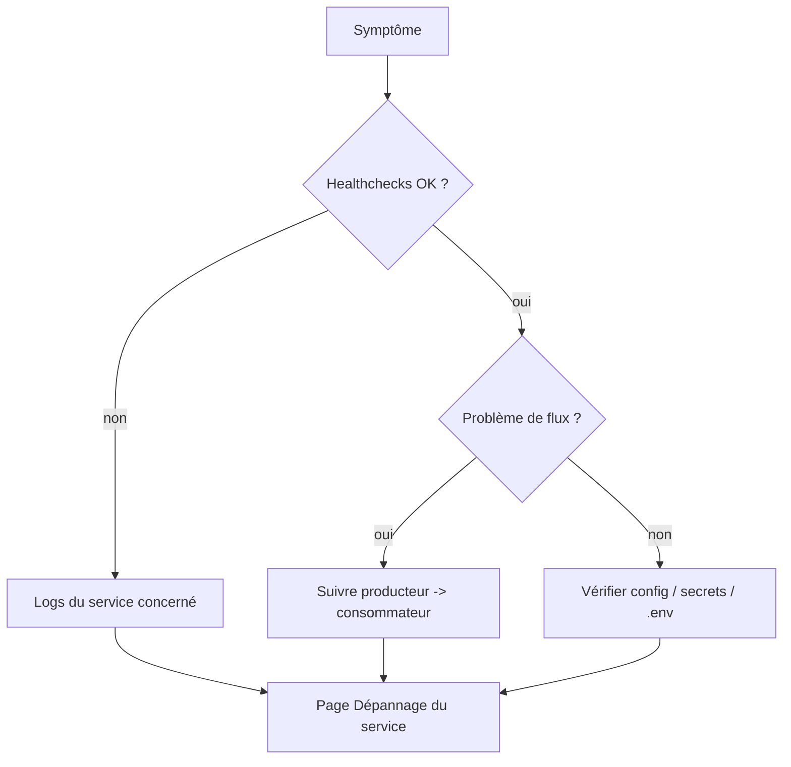

# Troubleshooting (index transverse)

Point d'entrée unique vers les guides de dépannage. Les problèmes détaillés sont documentés
**par service**.

## Par symptôme

| Symptôme | Cause probable | Où regarder |
|----------|----------------|-------------|
| Conteneur ne résout pas `netbox`/`lorion03vel-neo4j` | résolution DNS interne vs hôte | [Réseau](../architecture/networking.md) |
| `invalid reference format … must be lowercase` | `$` manquant dans l'image | [Neo4j / Dépannage](../services/neo4j/troubleshooting.md) |
| `UnsupportedClassVersionError` | plugin Java 21 sur Neo4j Java 17 | [Neo4j / Dépannage](../services/neo4j/troubleshooting.md) |
| Neo4j `unhealthy` mais fonctionne | ancien healthcheck `curl` | [Neo4j / Monitoring](../services/neo4j/monitoring.md) |
| « Connection reset by peer » ClickHouse | `listen_host` masqué | [ClickHouse / Dépannage](../services/clickhouse/troubleshooting.md) |
| Webhook **400** « Payload incomplet » | `object_type` vs `model` | [sync / Dépannage](../services/netbox-neo4j-sync/troubleshooting.md) |
| Webhook **401** | `WEBHOOK_SECRET` désaligné | [sync / Sécurité](../services/netbox-neo4j-sync/security.md) |
| Relations manquantes | paramètre `brief` envoyé à l'API | [sync / Reconciler](../services/netbox-neo4j-sync/reconciler.md) |
| `NETBOX_TOKEN est vide` | token non renseigné | [sync / Configuration](../services/netbox-neo4j-sync/configuration.md) |
| Webhook non reçu | worker NetBox / réseau | [NetBox / Worker](../services/netbox/worker.md) |
| Réseau « incorrect label » | réseau non `external` | [Neo4j / Dépannage](../services/neo4j/troubleshooting.md) |

## Méthode générale

1. **Healthchecks** : `docker compose ps` — isoler le service en faute.
2. **Logs** : `docker compose logs <service>`.
3. **Flux** : diagnostiquer **du producteur vers le consommateur** (ex. NetBox worker →
   receiver → Neo4j).
4. **Config** : vérifier `.env`, secrets, alignement des mots de passe.

## Rappels d'environnement

!!! warning
    - Les **conteneurs n'ont pas d'accès Internet** (proxy hôte uniquement).
    - Les **noms de service** ne résolvent que **depuis les conteneurs** du réseau.
    - Voir [Infrastructure](../architecture/infrastructure.md) et [Réseau](../architecture/networking.md).
